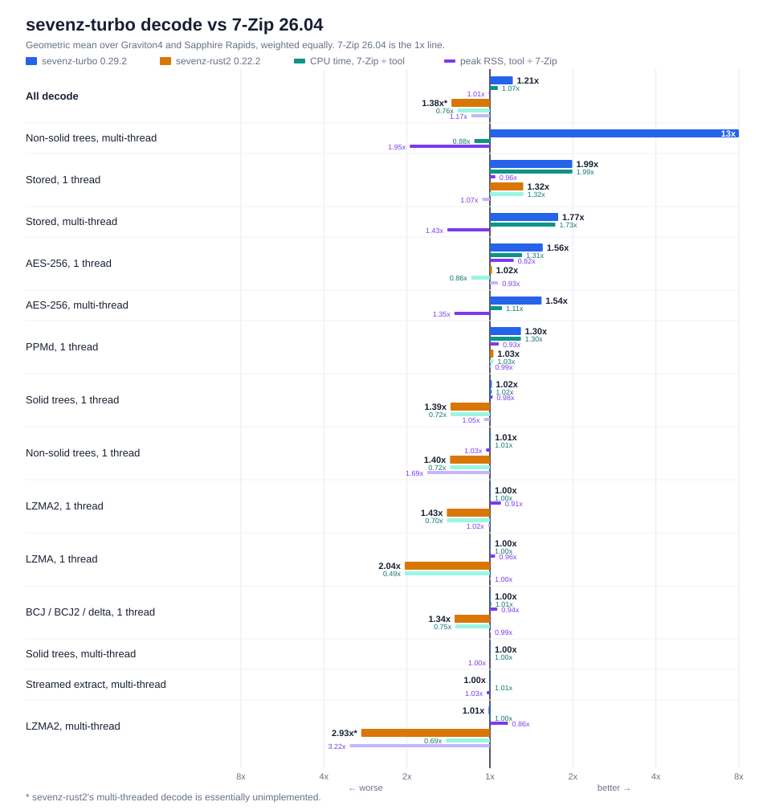
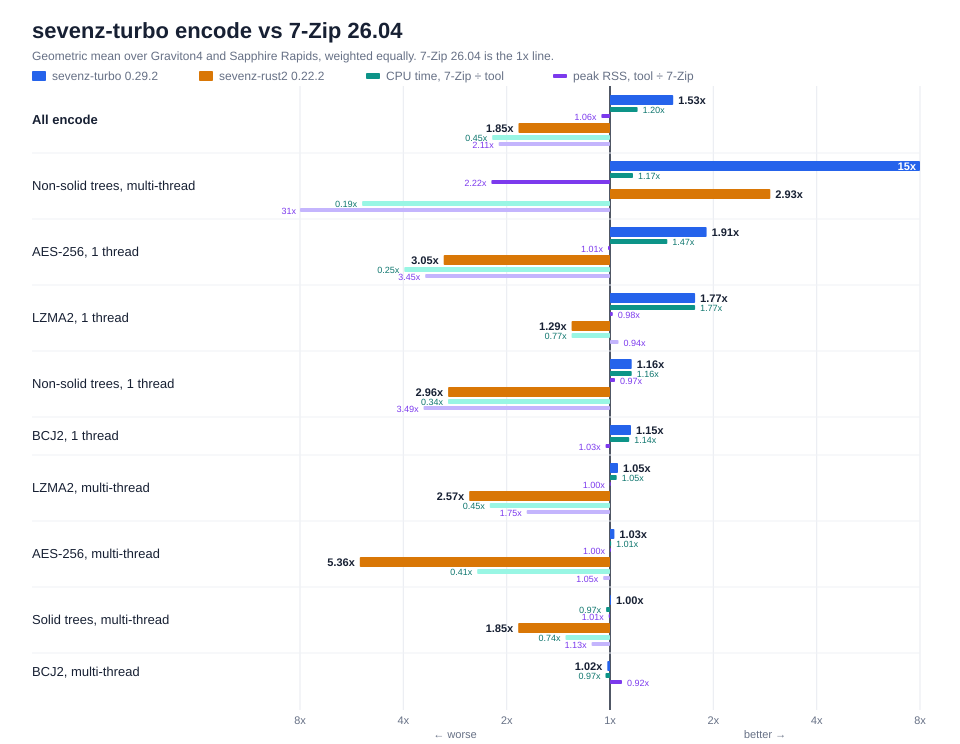

# Benchmarks

Current measurements of sevenz-turbo 0.29.2 against 7-Zip 26.04 and
sevenz-rust2 0.22.2 on two CPUs.
Taken 2026-10-21 with the fleet harness in
[`bench/sevenz-turbo-bench`](../bench/sevenz-turbo-bench) (`--profile fleet`,
3 timed repeats after 1 warm-up, medians). How to reproduce a measurement is
in [benchmarking.md](benchmarking.md). Earlier results, including the
five-machine 0.27.0 round of 2026-10-13 and the 0.29.1 round of 2026-10-18,
are in this file's git history.

The charts average both hosts (geometric mean per host, then across hosts,
each host weighted equally) and group the rows by kind of work. 7-Zip is the
1x line; each tool's bar is 7-Zip's wall time over the tool's, so a bar to
the right is faster than 7-Zip and one to the left slower. The two thin bars
under it are CPU time and peak RSS on the same scale, right of the line again
better (the RSS figure is labelled the tool's peak over 7-Zip's, so 0.5x
there is half 7-Zip's memory). `All decode` and `All encode` are the summary
rows below, averaged over the two hosts. The
memory-budget, adaptive and decode-ledger rows are left off. The harness
draws them with `sevenz-turbo-bench chart`.

Every ratio is **reference / sevenz-turbo**, so above 1.000 means
sevenz-turbo took less wall time, less CPU time or less peak memory than the
reference on that row. Values below 0.970 are in bold. A dash means the row
was not run on that host. Thread counts: `T1`, `T2`, `T4`, `T8` are fixed,
`Tall` is every hardware thread the host has.

Build: `sevenz-turbo` 0.29.2 (harness commit 5cdcbea) default features
(`aws-lc-rs` 1.18.1 crypto backend, `lzma-turbo` 0.10.2, `crc-turbo` 1.11.0,
`ppmd-turbo` 0.2.0), release profile, rustc 1.97.1. 7-Zip is the official
26.04 binary for each platform. sevenz-rust2 is the released 0.22.2 crate,
on the decode and encode rows. Its decode reads the archive through the
harness's buffered input (see
[sevenz-turbo vs sevenz-rust2](#sevenz-turbo-vs-sevenz-rust2)). Five decode
rows, `decode/bcj2/T1`, `decode/aes_kdf/T1`, `decode/tree_solid/T1`,
`decode/tree_nonsolid/T1` and `decode/bcj_arm64/T1`, were measured again
later the same day with every tool, at harness commit f10a6c7, after the
buffered input was fixed for interleaved pack streams; those rows replace
the first run's on both hosts.

## Hosts

| column | CPU | threads | OS | 7-Zip build |
| --- | --- | ---: | --- | --- |
| Sapphire Rapids | Intel Xeon Platinum 8488C (Sapphire Rapids, AVX-512) | 16 | Linux, c7i.4xlarge | 7-Zip (z) 26.04 (x64) |
| Graviton4 | AWS Graviton4 (Neoverse V2, SVE2) | 16 | Linux, c8g.4xlarge | 7-Zip (z) 26.04 (arm64) |

Both hosts were idle.

## Summary

Geometric mean of the per-row ratios on each host. Decode covers every
default-build `decode` row and encode every `encode` row, except the
memory-budget and adaptive rows, which are by design and listed separately
below. Peak RSS covers the decode and encode rows against 7-Zip, and the
decode rows against sevenz-rust2.

| CPU | threads | vs 7-Zip: decode wall | encode wall | peak RSS | vs sevenz-rust2: decode wall | encode wall | decode peak RSS |
| --- | ---: | ---: | ---: | ---: | ---: | ---: | ---: |
| Sapphire Rapids | 16 | 1.28 | 1.57 | 0.97 | 1.52 | 3.10 | 1.32 |
| Graviton4 | 16 | 1.15 | 1.48 | 0.98 | 1.62 | 2.89 | 1.36 |

## sevenz-turbo vs 7-Zip

Default build, one table per scenario group. `list` rows parse the header and
walk every entry; 7-Zip's `l -slt` also formats every property. This round
ran the decode and encode rows only, so the `list` rows are the 0.29.1 round's
of 2026-10-18.

### container parse

| scenario | Sapphire Rapids wall | Sapphire Rapids CPU | Sapphire Rapids RSS | Graviton4 wall | Graviton4 CPU | Graviton4 RSS |
| --- | ---: | ---: | ---: | ---: | ---: | ---: |
| `list/tree_solid` | 5.256 | 5.459 | 1.088 | 5.728 | 5.821 | 1.143 |
| `list/tree_nonsolid` | 4.204 | 4.373 | 1.012 | 4.608 | 4.646 | 1.069 |
| `list/mt` | 1.724 | 1.982 | 1.250 | 1.809 | 1.915 | 1.413 |
| `list/aes_kdf` | 1.422 | 1.414 | 1.059 | 1.690 | 1.695 | 1.159 |

### lzma2 single-stream

| scenario | Sapphire Rapids wall | Sapphire Rapids CPU | Sapphire Rapids RSS | Graviton4 wall | Graviton4 CPU | Graviton4 RSS |
| --- | ---: | ---: | ---: | ---: | ---: | ---: |
| `decode/st/T1` | 1.011 | 1.011 | 1.034 | 1.003 | 1.003 | 1.041 |
| `decode/st/Tall` | 1.008 | 1.008 | 3.076 | 1.001 | 1.001 | 3.129 |

### lzma2 parallel

| scenario | Sapphire Rapids wall | Sapphire Rapids CPU | Sapphire Rapids RSS | Graviton4 wall | Graviton4 CPU | Graviton4 RSS |
| --- | ---: | ---: | ---: | ---: | ---: | ---: |
| `decode/mt/T1` | 1.011 | 1.011 | 1.038 | 1.003 | 1.003 | 1.041 |
| `decode/mt/T2` | 0.997 | 1.004 | 1.000 | 0.998 | 1.001 | 1.001 |
| `decode/mt/T4` | 0.992 | 1.002 | 1.000 | 0.998 | 1.000 | 1.001 |
| `decode/mt/T8` | 0.982 | 1.002 | 1.000 | 0.992 | 1.000 | 1.000 |
| `decode/mt/Tall` | 0.979 | 1.000 | 1.000 | 0.992 | 1.000 | 1.000 |
| `decode/mt/Tall/no-verify` | 0.987 | 1.007 | 1.000 | 0.994 | 1.001 | 1.000 |
| `decode/mt/Tall/stream` | 0.975 | 0.999 | 1.000 | 0.993 | 1.000 | 1.000 |

### lzma2 near-incompressible

| scenario | Sapphire Rapids wall | Sapphire Rapids CPU | Sapphire Rapids RSS | Graviton4 wall | Graviton4 CPU | Graviton4 RSS |
| --- | ---: | ---: | ---: | ---: | ---: | ---: |
| `decode/media_mx1/T1` | 1.006 | 1.006 | 1.251 | 0.999 | 0.999 | 1.333 |
| `decode/media_mx1/Tall` | **0.956** | 1.016 | 1.070 | 0.972 | 1.001 | 1.082 |
| `decode/media_mx5/T1` | 1.007 | 1.007 | 1.040 | 1.000 | 1.000 | 1.041 |
| `decode/media_mx5/Tall` | 0.981 | 0.998 | 1.000 | 0.990 | 1.000 | 1.000 |

### decode ledger

| scenario | Sapphire Rapids wall | Sapphire Rapids CPU | Sapphire Rapids RSS | Graviton4 wall | Graviton4 CPU | Graviton4 RSS |
| --- | ---: | ---: | ---: | ---: | ---: | ---: |
| `decode/media_mx5_3g/T2/ledger` | 0.995 | 1.003 | 1.000 | 0.998 | 1.001 | 1.000 |
| `decode/media_mx5_3g/T4/ledger` | 1.000 | 1.004 | 1.000 | 0.997 | 1.000 | 1.000 |
| `decode/media_mx5_3g/T8/ledger` | 0.990 | 1.001 | 1.000 | 0.996 | 1.000 | 1.000 |
| `decode/media_mx5_3g/Tall/ledger` | 0.981 | 1.000 | 1.000 | 0.988 | 0.999 | 1.000 |
| `decode/media_mx5_2g/T2/ledger` | 0.995 | 1.002 | 1.000 | 0.998 | 1.001 | 1.000 |
| `decode/media_mx5_2g/T4/ledger` | 0.996 | 1.003 | 1.000 | 0.997 | 1.000 | 1.000 |
| `decode/media_mx5_2g/T8/ledger` | 0.983 | 1.000 | 1.000 | 0.993 | 1.000 | 1.000 |
| `decode/media_mx5_2g/Tall/ledger` | **0.953** | 1.004 | 1.000 | 0.973 | 1.000 | 1.000 |
| `decode/mt/T2/ledger` | 0.996 | 1.003 | 1.000 | 0.998 | 1.001 | 1.001 |
| `decode/mt/T4/ledger` | 0.997 | 1.004 | 1.000 | 0.996 | 1.000 | 1.001 |
| `decode/mt/T8/ledger` | 0.979 | 0.999 | 1.000 | 0.992 | 1.000 | 1.000 |
| `decode/mt/Tall/ledger` | 0.982 | 1.002 | 1.000 | 0.992 | 1.000 | 1.000 |
| `decode/media_mx1/T2/ledger` | 0.991 | 1.005 | 1.026 | 1.002 | 1.001 | 1.072 |
| `decode/media_mx1/T4/ledger` | 0.991 | 1.004 | 1.053 | 1.002 | 1.002 | 1.069 |
| `decode/media_mx1/T8/ledger` | 0.991 | 0.996 | 1.060 | 1.002 | 1.001 | 1.075 |
| `decode/aes_mx1/T2/ledger` | 1.013 | 1.011 | 1.108 | 1.000 | 1.001 | 1.132 |
| `decode/aes_mx1/T4/ledger` | 1.005 | 1.006 | 1.134 | 1.000 | 1.001 | 1.148 |
| `decode/aes_mx1/T8/ledger` | 1.014 | 1.006 | 1.142 | 1.001 | 1.001 | 1.147 |

### lzma

| scenario | Sapphire Rapids wall | Sapphire Rapids CPU | Sapphire Rapids RSS | Graviton4 wall | Graviton4 CPU | Graviton4 RSS |
| --- | ---: | ---: | ---: | ---: | ---: | ---: |
| `decode/lzma/T1` | 1.010 | 1.010 | 1.044 | 0.999 | 0.999 | 1.045 |

### solid vs non-solid

| scenario | Sapphire Rapids wall | Sapphire Rapids CPU | Sapphire Rapids RSS | Graviton4 wall | Graviton4 CPU | Graviton4 RSS |
| --- | ---: | ---: | ---: | ---: | ---: | ---: |
| `decode/tree_solid/T1` | 1.027 | 1.027 | 1.021 | 1.005 | 1.005 | 1.025 |
| `decode/tree_solid/Tall` | 0.995 | 1.000 | 0.999 | 0.984 | 0.986 | 0.999 |
| `decode/tree_solid/Tall/no-verify` | 1.036 | 1.037 | 0.999 | 0.991 | 0.992 | 1.000 |
| `decode/tree_solid/Tall/stream` | 1.012 | 1.015 | 0.998 | 0.999 | 1.003 | 0.999 |
| `decode/tree_nonsolid/T1` | 1.010 | 1.010 | 0.973 | 1.006 | 1.006 | **0.964** |
| `decode/tree_nonsolid/Tall` | 12.1 | **0.799** | **0.493** | 14.4 | **0.965** | **0.482** |
| `decode/tree_nonsolid/Tall/no-verify` | 12.1 | **0.794** | **0.547** | 14.4 | **0.969** | **0.529** |
| `decode/tree_nonsolid/Tall/stream` | 1.012 | 1.012 | **0.937** | 1.006 | 1.006 | **0.916** |

### stored

| scenario | Sapphire Rapids wall | Sapphire Rapids CPU | Sapphire Rapids RSS | Graviton4 wall | Graviton4 CPU | Graviton4 RSS |
| --- | ---: | ---: | ---: | ---: | ---: | ---: |
| `decode/store/T1` | 2.419 | 2.427 | 1.030 | 1.634 | 1.635 | 1.063 |
| `decode/store/T2` | 2.153 | 2.106 | **0.671** | 1.473 | 1.444 | **0.736** |
| `decode/store/T4` | 2.150 | 2.098 | **0.661** | 1.418 | 1.386 | **0.736** |
| `decode/store/T8` | 2.180 | 2.123 | **0.670** | 1.450 | 1.419 | **0.735** |

### aes-256

| scenario | Sapphire Rapids wall | Sapphire Rapids CPU | Sapphire Rapids RSS | Graviton4 wall | Graviton4 CPU | Graviton4 RSS |
| --- | ---: | ---: | ---: | ---: | ---: | ---: |
| `decode/aes_store/T1` | 2.237 | 1.850 | 1.323 | 1.141 | 1.156 | 1.437 |
| `decode/aes_store/T2` | 2.754 | 1.387 | **0.629** | 1.167 | **0.954** | **0.664** |
| `decode/aes_store/T4` | 2.808 | 1.393 | **0.624** | 1.119 | **0.902** | **0.664** |
| `decode/aes_store/T8` | 2.819 | 1.396 | **0.620** | 1.152 | **0.943** | **0.664** |
| `decode/aes_mx1/T1` | 0.996 | 1.006 | 1.291 | 0.991 | 0.998 | 1.370 |
| `decode/aes_mx1/Tall` | 0.995 | 1.021 | 1.140 | **0.969** | 1.001 | 1.145 |
| `decode/aes_kdf/T1` | 4.253 | 1.687 | 0.976 | 1.320 | 1.385 | 1.001 |

### filters

| scenario | Sapphire Rapids wall | Sapphire Rapids CPU | Sapphire Rapids RSS | Graviton4 wall | Graviton4 CPU | Graviton4 RSS |
| --- | ---: | ---: | ---: | ---: | ---: | ---: |
| `decode/bcj_x86/T1` | 1.066 | 1.029 | 1.057 | 0.998 | 0.999 | 1.058 |
| `decode/bcj_arm64/T1` | 0.991 | 1.013 | 1.058 | **0.933** | **0.959** | 1.058 |
| `decode/bcj2/T1` (vs `7zz -mmt=1 -mmtf=off`, the one-thread parity reference) | 1.035 | 1.035 | 1.088 | 0.999 | 0.999 | 1.086 |
| `decode/delta/T1` | 1.023 | 1.039 | 1.054 | 0.990 | 1.021 | 1.058 |

### ppmd (secondary)

| scenario | Sapphire Rapids wall | Sapphire Rapids CPU | Sapphire Rapids RSS | Graviton4 wall | Graviton4 CPU | Graviton4 RSS |
| --- | ---: | ---: | ---: | ---: | ---: | ---: |
| `decode/ppmd/T1` | 1.291 | 1.291 | 1.074 | 1.300 | 1.300 | 1.078 |

### encode

| scenario | Sapphire Rapids wall | Sapphire Rapids CPU | Sapphire Rapids RSS | Graviton4 wall | Graviton4 CPU | Graviton4 RSS |
| --- | ---: | ---: | ---: | ---: | ---: | ---: |
| `encode/payload-sub/L1/T1` | 1.194 | 1.194 | 1.088 | 1.154 | 1.154 | 1.108 |
| `encode/payload-sub/L1/Tall` | 1.049 | 1.008 | **0.880** | 1.209 | 1.209 | **0.943** |
| `encode/payload-sub/L3/T1` | 1.336 | 1.336 | 1.009 | 1.260 | 1.259 | 1.014 |
| `encode/payload-sub/L3/Tall` | 1.140 | 1.138 | 0.994 | 1.219 | 1.305 | 0.997 |
| `encode/payload-sub/L5/T1` | 2.390 | 2.390 | 0.993 | 2.133 | 2.142 | 0.995 |
| `encode/payload-sub/L5/Tall` | 0.999 | 0.991 | 0.998 | 1.040 | 1.019 | 0.999 |
| `encode/payload-sub/L7/T1` | 2.403 | 2.403 | 0.996 | 2.197 | 2.197 | 0.997 |
| `encode/payload-sub/L7/Tall` | 0.998 | 0.997 | 1.002 | 1.028 | 1.011 | 0.999 |
| `encode/payload-sub/L9/T1` | 2.301 | 2.301 | 0.999 | 2.098 | 2.098 | 0.999 |
| `encode/payload-sub/L9/Tall` | 1.001 | 0.992 | 1.000 | **0.969** | 0.972 | 1.001 |
| `encode/payload-sub/L5/T2` | 1.088 | 1.072 | 1.000 | 1.125 | 1.082 | 1.004 |
| `encode/payload-sub/L5/T4` | 0.996 | 0.990 | 1.094 | 1.047 | 1.021 | 1.001 |
| `encode/payload-sub/L5/T8` | 0.999 | 0.991 | 1.038 | 1.013 | 1.000 | 1.047 |
| `encode/tree/L5/Tall/solid` | 1.002 | 0.980 | 0.992 | 1.007 | **0.968** | 0.991 |
| `encode/tree/L5/Tall/non-solid` | 12.1 | **0.696** | **0.339** | 13.3 | 0.995 | **0.322** |
| `encode/tree/L5/T1/non-solid` | **0.968** | **0.968** | 1.023 | 0.987 | 0.987 | 1.027 |
| `encode/kdf-tree/L5/T1/non-solid` | 1.294 | 1.295 | 1.028 | 1.446 | 1.446 | 1.059 |
| `encode/kdf-tree/L5/Tall/non-solid` | 25.1 | 1.451 | **0.621** | 12.0 | 1.846 | **0.613** |

### encode bcj2

| scenario | Sapphire Rapids wall | Sapphire Rapids CPU | Sapphire Rapids RSS | Graviton4 wall | Graviton4 CPU | Graviton4 RSS |
| --- | ---: | ---: | ---: | ---: | ---: | ---: |
| `encode/bcj2/L5/T1` | 1.200 | 1.183 | 0.970 | 1.105 | 1.094 | 0.972 |
| `encode/bcj2/L5/T4` | 0.991 | 0.981 | 1.082 | 0.971 | **0.960** | 1.088 |
| `encode/bcj2/L5/Tall` | 0.995 | 0.983 | 1.081 | 0.970 | **0.958** | 1.084 |

### encode aes-256

| scenario | Sapphire Rapids wall | Sapphire Rapids CPU | Sapphire Rapids RSS | Graviton4 wall | Graviton4 CPU | Graviton4 RSS |
| --- | ---: | ---: | ---: | ---: | ---: | ---: |
| `encode/payload-sub/L5/Tall/aes` | 1.023 | 0.997 | 0.999 | 1.038 | 1.018 | 1.000 |
| `encode/kdf-tree/L5/T1/non-solid/aes` | 2.717 | 1.576 | 0.979 | 1.344 | 1.369 | 0.994 |

Archive size ratio (7-Zip bytes / sevenz-turbo bytes at the same settings)
is 1.000 on every encode row on both hosts except the `kdf-tree` rows (0.996
to 0.997, about 0.4% larger) and `encode/payload-sub/L5/T2` (0.999). The
harness compares sizes, not bytes; salts, IVs and file attributes make equal
recipes differ byte for byte.

## By design: memory budget and adaptive rows

These rows measure what honouring a decode memory budget costs, and weaver's
adaptive chase decode (`set_adaptive_lzma2` plus `set_threads(1)`, widened
every 100 ms). 7-Zip has no decode budget and no adaptive mode, so it runs
unbounded at the same thread count on every one of them. They are not parity
targets.

| scenario | Sapphire Rapids wall | Sapphire Rapids CPU | Sapphire Rapids RSS | Graviton4 wall | Graviton4 CPU | Graviton4 RSS |
| --- | ---: | ---: | ---: | ---: | ---: | ---: |
| `decode/mt/Tall/adaptive` | **0.234** | 1.037 | 3.977 | **0.227** | 1.019 | 3.984 |
| `decode/media_mx5/Tall/adaptive` | **0.233** | 1.031 | 3.979 | **0.226** | 1.018 | 3.986 |
| `decode/media_mx5/Tall/adaptive/budget-4096MiB` | **0.233** | 1.026 | 3.978 | **0.226** | 1.018 | 3.986 |
| `decode/media_mx5_3g/T2/budget-553MiB/ledger` | 0.995 | 1.003 | 1.000 | 0.998 | 1.001 | 1.000 |
| `decode/media_mx5_3g/T4/budget-1065MiB/ledger` | 0.989 | 1.001 | 1.000 | 0.998 | 1.001 | 1.000 |
| `decode/media_mx5_3g/T8/budget-2089MiB/ledger` | 0.987 | 0.999 | 1.000 | 0.995 | 1.000 | 1.000 |
| `decode/media_mx5_2g/T2/budget-553MiB/ledger` | 0.994 | 1.002 | 1.000 | 0.998 | 1.001 | 1.000 |
| `decode/media_mx5_2g/T4/budget-1065MiB/ledger` | 0.992 | 1.001 | 1.000 | 0.997 | 1.000 | 1.000 |
| `decode/media_mx5_2g/T8/budget-2089MiB/ledger` | 0.982 | 0.998 | 1.000 | 0.993 | 1.000 | 1.000 |
| `decode/mt/T2/budget-553MiB/ledger` | 0.997 | 1.003 | 1.001 | 0.998 | 1.001 | 1.001 |
| `decode/mt/T4/budget-1065MiB/ledger` | 0.993 | 1.002 | 1.000 | 0.998 | 1.000 | 1.000 |
| `decode/mt/T8/budget-2089MiB/ledger` | 0.984 | 1.001 | 1.000 | 0.992 | 1.000 | 1.000 |
| `decode/mt/T8/budget-64MiB` | **0.149** | 1.055 | 52.5 | **0.143** | 1.024 | 53.6 |
| `decode/mt/T2/budget-553MiB` | 0.997 | 1.004 | 1.000 | 0.998 | 1.001 | 1.001 |
| `decode/mt/T4/budget-1065MiB` | 0.992 | 1.000 | 1.000 | 0.997 | 1.000 | 1.001 |
| `decode/mt/T8/budget-2089MiB` | 0.990 | 1.011 | 1.000 | 0.992 | 1.000 | 1.000 |

## sevenz-turbo vs sevenz-rust2

Ratios are sevenz-rust2 0.22.2 / sevenz-turbo, from the same run's
sevenz-rust2 rows. sevenz-rust2 decodes on at most a few threads, so on
`decode/mt/Tall` it holds less memory and takes several times the wall time;
on `decode/st/Tall` it holds many times more.

sevenz-rust2's decode reads the archive through the harness's buffered input
rather than a bare `File`, which is how it is meant to be fed: its LZMA range
decoder takes one byte per read, so unbuffered, `decode/lzma/T1` paid a system
call per compressed byte (10.3x and 14.9x in the 2026-10-18 round, mostly
system time). A plain `BufReader` is no fix for every row, though:
sevenz-rust2 seeks before every read of a pack stream, and each seek empties
the buffer, so a BCJ2 folder's four interleaved streams refilled it on every
small read (`decode/bcj2/T1` at about 0.01x of 7-Zip). The harness therefore
reads the archive through a small cache of windows in which a seek only moves
the position; the five rows the build note names were measured with it, the
others with the `BufReader`, which reads them the same way.

### decode

| scenario | Sapphire Rapids wall | Sapphire Rapids CPU | Sapphire Rapids RSS | Graviton4 wall | Graviton4 CPU | Graviton4 RSS |
| --- | ---: | ---: | ---: | ---: | ---: | ---: |
| `decode/st/T1` | 1.412 | 1.412 | 1.043 | 1.462 | 1.462 | 1.045 |
| `decode/st/Tall` | 1.449 | 1.450 | 61.8 | 1.487 | 1.490 | 63.1 |
| `decode/mt/T1` | 1.412 | 1.412 | 1.047 | 1.464 | 1.464 | 1.048 |
| `decode/mt/Tall` | 8.428 | 1.391 | **0.441** | 3.971 | 1.466 | **0.605** |
| `decode/media_mx1/T1` | 1.411 | 1.411 | 1.304 | 1.470 | 1.470 | 1.393 |
| `decode/media_mx5/T1` | 1.417 | 1.417 | 1.046 | 1.470 | 1.470 | 1.045 |
| `decode/lzma/T1` | 1.506 | 1.506 | 1.042 | 2.782 | 2.782 | 1.041 |
| `decode/tree_solid/T1` | 1.460 | 1.460 | 1.076 | 1.363 | 1.363 | 1.075 |
| `decode/tree_nonsolid/T1` | 1.376 | 1.376 | 1.605 | 1.437 | 1.437 | 1.663 |
| `decode/store/T1` | 1.083 | 1.084 | 1.103 | 2.092 | 2.094 | 1.131 |
| `decode/aes_store/T1` | 1.496 | 1.497 | **0.905** | 2.281 | 2.281 | **0.903** |
| `decode/aes_mx1/T1` | 1.400 | 1.400 | 1.217 | 1.458 | 1.458 | 1.323 |
| `decode/aes_kdf/T1` | 1.314 | 1.314 | 1.255 | 1.394 | 1.394 | 1.318 |
| `decode/bcj_x86/T1` | 1.288 | 1.289 | 1.046 | 1.348 | 1.348 | 1.041 |
| `decode/bcj_arm64/T1` | 1.340 | 1.340 | 1.073 | 1.296 | 1.296 | 1.076 |
| `decode/bcj2/T1` | 1.399 | 1.399 | 1.067 | 1.374 | 1.374 | 1.067 |
| `decode/delta/T1` | 1.348 | 1.348 | 1.048 | 1.399 | 1.399 | 1.045 |
| `decode/ppmd/T1` | 1.315 | 1.315 | 1.064 | 1.203 | 1.203 | 1.068 |

### encode

sevenz-rust2 encodes through its own pure-Rust LZMA2 coder, multi-threaded
on the `Tall` rows. Its archives come out within 0.6% of 7-Zip's at the same
settings on every row, either side (7-Zip / sevenz-rust2 bytes 0.994 to
1.006), so the rows compare time and memory.

| scenario | Sapphire Rapids wall | Sapphire Rapids CPU | Sapphire Rapids RSS | Graviton4 wall | Graviton4 CPU | Graviton4 RSS |
| --- | ---: | ---: | ---: | ---: | ---: | ---: |
| `encode/payload-sub/L1/T1` | 1.567 | 1.563 | **0.877** | 1.494 | 1.494 | **0.845** |
| `encode/payload-sub/L1/Tall` | 1.403 | 1.396 | 1.588 | 1.433 | 1.406 | 1.710 |
| `encode/payload-sub/L3/T1` | 1.821 | 1.821 | 0.985 | 1.844 | 1.844 | 0.982 |
| `encode/payload-sub/L3/Tall` | 1.374 | 1.371 | 1.109 | 1.430 | 1.515 | 1.111 |
| `encode/payload-sub/L5/T1` | 3.103 | 3.103 | 0.985 | 2.661 | 2.673 | 0.985 |
| `encode/payload-sub/L5/Tall` | 3.504 | 2.024 | 1.047 | 4.521 | 2.679 | 1.047 |
| `encode/payload-sub/L7/T1` | 3.026 | 3.026 | 0.993 | 2.649 | 2.649 | 0.992 |
| `encode/payload-sub/L7/Tall` | 4.571 | 2.711 | 1.068 | 4.531 | 2.679 | 1.066 |
| `encode/payload-sub/L9/T1` | 2.975 | 2.975 | 0.998 | 2.557 | 2.557 | 0.998 |
| `encode/payload-sub/L9/Tall` | 4.390 | 2.955 | 1.689 | 3.746 | 2.580 | 1.690 |
| `encode/payload-sub/L5/T2` | 3.154 | 3.299 | 4.786 | 2.688 | 2.890 | 4.823 |
| `encode/payload-sub/L5/T4` | 2.921 | 3.133 | 2.506 | 2.602 | 2.888 | 2.513 |
| `encode/payload-sub/L5/T8` | 2.554 | 2.808 | 2.068 | 2.450 | 2.791 | 2.086 |
| `encode/tree/L5/Tall/solid` | 1.818 | 1.237 | 1.122 | 1.904 | 1.393 | 1.121 |
| `encode/tree/L5/Tall/non-solid` | 2.660 | 2.659 | 8.677 | 2.284 | 2.263 | 8.524 |
| `encode/tree/L5/T1/non-solid` | 1.744 | 1.744 | 3.408 | 2.008 | 2.008 | 3.487 |
| `encode/kdf-tree/L5/T1/non-solid` | 7.082 | 7.094 | 3.658 | 5.556 | 5.556 | 3.906 |
| `encode/kdf-tree/L5/Tall/non-solid` | 15.4 | 23.5 | 21.4 | 7.063 | 10.1 | 23.0 |
| `encode/payload-sub/L5/Tall/aes` | 4.543 | 2.098 | 1.046 | 6.704 | 2.872 | 1.047 |
| `encode/kdf-tree/L5/T1/non-solid/aes` | 6.376 | 6.382 | 3.317 | 5.338 | 5.339 | 3.501 |

## Other variants

`native-crypto` is a non-default build with the RustCrypto backend instead
of `aws-lc-rs`. `no-ledger` is the default build run without `--ledger`:
the `ledger` rows above ask the reader to keep an accounting of its parallel
LZMA2 decode (`Lzma2Handle::keep_ledger`) and report it, which no consumer
does unless it asks; `no-ledger` is the same decode as a consumer runs it.
Both are against 7-Zip on the same rows.

### native-crypto

| scenario | Sapphire Rapids wall | Sapphire Rapids CPU | Sapphire Rapids RSS | Graviton4 wall | Graviton4 CPU | Graviton4 RSS |
| --- | ---: | ---: | ---: | ---: | ---: | ---: |
| `decode/aes_mx1/T2/ledger` | 1.009 | 1.008 | 1.132 | 0.995 | 0.996 | 1.147 |
| `decode/aes_mx1/T4/ledger` | 1.004 | 1.004 | 1.127 | 0.995 | 0.996 | 1.159 |
| `decode/aes_mx1/T8/ledger` | 1.013 | 1.004 | 1.140 | 0.995 | 0.996 | 1.154 |
| `decode/aes_store/T1` | 1.931 | 1.597 | 1.361 | **0.754** | **0.765** | 1.403 |
| `decode/aes_store/T2` | 2.338 | 1.255 | **0.637** | **0.698** | **0.602** | **0.657** |
| `decode/aes_store/T4` | 2.346 | 1.238 | **0.627** | **0.696** | **0.600** | **0.657** |
| `decode/aes_store/T8` | 2.358 | 1.246 | **0.623** | **0.724** | **0.638** | **0.657** |
| `decode/aes_mx1/T1` | 0.995 | 1.005 | 1.280 | 0.987 | 0.994 | 1.407 |
| `decode/aes_mx1/Tall` | 0.981 | 1.018 | 1.141 | **0.938** | 0.996 | 1.149 |
| `decode/aes_kdf/T1` | 4.261 | 1.688 | 0.995 | 1.285 | 1.348 | 1.035 |
| `encode/payload-sub/L5/Tall/aes` | 1.017 | 0.995 | 1.000 | 1.004 | 1.019 | 1.000 |
| `encode/kdf-tree/L5/T1/non-solid/aes` | 2.716 | 1.575 | 0.985 | 1.343 | 1.367 | 1.007 |

### no-ledger

| scenario | Sapphire Rapids wall | Sapphire Rapids CPU | Sapphire Rapids RSS | Graviton4 wall | Graviton4 CPU | Graviton4 RSS |
| --- | ---: | ---: | ---: | ---: | ---: | ---: |
| `decode/media_mx5_3g/T2/ledger` | 0.995 | 1.003 | 1.000 | 0.998 | 1.001 | 1.000 |
| `decode/media_mx5_3g/T4/ledger` | 1.000 | 1.004 | 1.000 | 0.998 | 1.001 | 1.000 |
| `decode/media_mx5_3g/T8/ledger` | 0.989 | 0.999 | 1.000 | 0.996 | 1.000 | 1.000 |
| `decode/media_mx5_3g/Tall/ledger` | 0.987 | 1.000 | 1.000 | 0.989 | 0.999 | 1.000 |
| `decode/media_mx5_2g/T2/ledger` | 0.995 | 1.002 | 0.999 | 0.998 | 1.001 | 1.000 |
| `decode/media_mx5_2g/T4/ledger` | 0.998 | 1.005 | 1.000 | 0.998 | 1.001 | 1.000 |
| `decode/media_mx5_2g/T8/ledger` | 0.984 | 1.000 | 1.000 | 0.994 | 1.000 | 1.000 |
| `decode/media_mx5_2g/Tall/ledger` | **0.955** | 1.002 | 1.000 | 0.972 | 0.999 | 1.000 |
| `decode/mt/T2/ledger` | 0.996 | 1.004 | 1.000 | 0.998 | 1.001 | 1.001 |
| `decode/mt/T4/ledger` | 0.997 | 1.004 | 1.000 | 0.998 | 1.001 | 1.001 |
| `decode/mt/T8/ledger` | 0.980 | 1.002 | 1.000 | 0.991 | 0.999 | 1.000 |
| `decode/mt/Tall/ledger` | 0.982 | 1.002 | 1.000 | 0.991 | 1.000 | 1.000 |
| `decode/media_mx1/T2/ledger` | 0.992 | 1.003 | 1.052 | 1.002 | 1.002 | 1.077 |
| `decode/media_mx1/T4/ledger` | 0.993 | 1.005 | 1.054 | 1.002 | 1.002 | 1.056 |
| `decode/media_mx1/T8/ledger` | 0.994 | 1.001 | 1.061 | 1.002 | 1.001 | 1.076 |
| `decode/aes_mx1/T2/ledger` | 1.012 | 1.011 | 1.109 | 1.000 | 1.001 | 1.132 |
| `decode/aes_mx1/T4/ledger` | 1.006 | 1.006 | 1.131 | 1.000 | 1.001 | 1.149 |
| `decode/aes_mx1/T8/ledger` | 1.007 | 1.005 | 1.139 | 1.000 | 1.001 | 1.147 |
