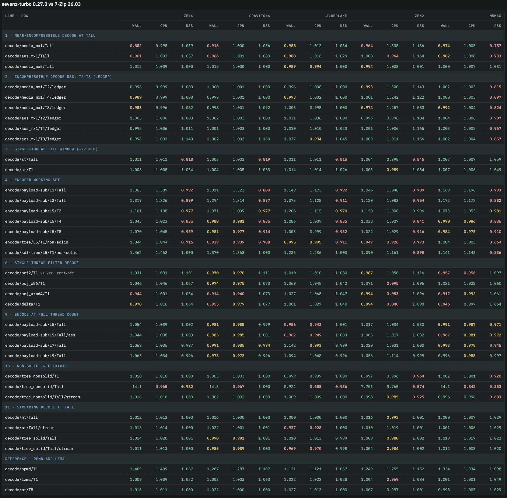
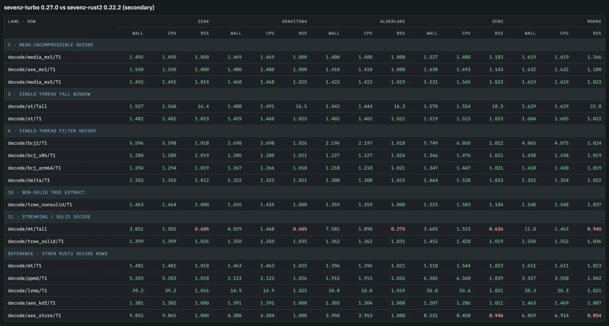

# Benchmarks

Current fleet measurements of sevenz-turbo 0.27.0 against 7-Zip 26.03 and
sevenz-rust2 0.22.2 on five CPUs. Taken 2026-10-13 with the fleet harness in
[`bench/sevenz-turbo-bench`](../bench/sevenz-turbo-bench) (`--profile fleet`,
3 timed repeats after 1 warm-up, medians). How to reproduce a measurement is
in [benchmarking.md](benchmarking.md). Earlier results are in this file's
git history.

Every ratio is **reference / sevenz-turbo**, so above 1.000 means
sevenz-turbo took less wall time, less CPU time or less peak memory than the
reference on that row. Values below 0.970 are in bold. A dash means the row
was not run on that host. Thread counts: `T1`, `T2`, `T4`, `T8` are fixed,
`Tall` is every hardware thread the host has.

Build: `sevenz-turbo` 0.27.0 default features (`aws-lc-rs` 1.18.1 crypto
backend, `lzma-turbo` 0.9.0, `ppmd-turbo` 0.1.1), release profile,
rustc 1.97.1. 7-Zip is the official 26.03 binary for each platform.
sevenz-rust2 is the released 0.22.2 crate, decode rows only.

## Hosts

| column | CPU | threads | OS | 7-Zip build |
| --- | --- | ---: | --- | --- |
| Zen 4 | AMD EPYC 9R14 (Zen 4, AVX-512) | 16 | Linux, c7a.4xlarge | 7-Zip (z) 26.03 (x64) |
| Graviton4 | AWS Graviton4 (Neoverse V2, SVE2) | 16 | Linux, c8g.4xlarge | 7-Zip (z) 26.03 (arm64) |
| Alder Lake | Intel Core i5-1240P (Alder Lake, hybrid P/E) | 16 | Linux | 7-Zip (z) 26.03 (x64) |
| Zen 2 | AMD Ryzen 5 3600 (Zen 2) | 12 | Windows | 7-Zip (a) 26.03 (x64) |
| M5 Max | Apple M5 Max | 18 | macOS, shared with other work during the run | 7-Zip (z) 26.03 (arm64) |

The M5 Max ran beside other work (load average 3.4 to 5.0 over the run), so
treat its small differences with care; the other four were idle.

## Summary

Geometric mean of the per-row ratios on each host. Decode and encode cover
every default-build row except the memory-budget and adaptive rows, which
are by design and listed separately below. Peak RSS covers both.

| CPU | threads | vs 7-Zip: decode wall | encode wall | peak RSS | vs sevenz-rust2: decode wall | peak RSS |
| --- | ---: | ---: | ---: | ---: | ---: | ---: |
| Zen 4 | 16 | 1.16 | 1.54 | 0.97 | 2.42 | 1.16 |
| Graviton4 | 16 | 1.12 | 1.45 | 0.97 | 1.95 | 1.16 |
| Alder Lake | 16 | 1.13 | 1.42 | 0.96 | 1.88 | 1.11 |
| Zen 2 | 12 | 1.10 | 1.33 | 0.98 | 2.51 | 1.19 |
| M5 Max | 18 | 1.13 | 1.38 | 0.93 | 2.44 | 1.24 |

## sevenz-turbo vs 7-Zip

Default build, one table per scenario group. `list` rows parse the header and
walk every entry; 7-Zip's `l -slt` also formats every property.

### container parse

| scenario | Zen 4 wall | Zen 4 CPU | Zen 4 RSS | Graviton4 wall | Graviton4 CPU | Graviton4 RSS | Alder Lake wall | Alder Lake CPU | Alder Lake RSS | Zen 2 wall | Zen 2 CPU | Zen 2 RSS | M5 Max wall | M5 Max CPU | M5 Max RSS |
| --- | ---: | ---: | ---: | ---: | ---: | ---: | ---: | ---: | ---: | ---: | ---: | ---: | ---: | ---: | ---: |
| `list/tree_solid` | 10.8 | 10.9 | 1.000 | 5.792 | 5.834 | 1.000 | 3.903 | 3.921 | 1.000 | — | — | — | 5.403 | 6.165 | 1.080 |
| `list/tree_nonsolid` | 6.690 | 6.777 | 1.000 | 3.580 | 3.598 | 1.000 | 2.567 | 2.587 | 1.000 | — | — | — | 4.131 | 4.493 | **0.817** |
| `list/mt` | 1.774 | 1.845 | 1.000 | 2.055 | 2.126 | 1.000 | 1.639 | 1.718 | 1.000 | — | — | — | 1.344 | 1.390 | 1.556 |
| `list/aes_kdf` | 1.916 | 1.922 | 1.000 | 1.671 | 1.673 | 1.000 | 1.337 | 1.351 | 1.000 | 1.250 | 1.000 | 1.231 | 1.522 | 1.554 | 1.108 |

### lzma2 single-stream

| scenario | Zen 4 wall | Zen 4 CPU | Zen 4 RSS | Graviton4 wall | Graviton4 CPU | Graviton4 RSS | Alder Lake wall | Alder Lake CPU | Alder Lake RSS | Zen 2 wall | Zen 2 CPU | Zen 2 RSS | M5 Max wall | M5 Max CPU | M5 Max RSS |
| --- | ---: | ---: | ---: | ---: | ---: | ---: | ---: | ---: | ---: | ---: | ---: | ---: | ---: | ---: | ---: |
| `decode/st/T1` | 1.008 | 1.008 | 1.054 | 1.004 | 1.005 | 1.063 | 1.014 | 1.014 | 1.026 | 1.003 | 0.989 | 1.084 | 1.007 | 1.006 | 1.049 |
| `decode/st/Tall` | 1.011 | 1.011 | **0.818** | 1.003 | 1.003 | **0.819** | 1.011 | 1.011 | **0.815** | 1.004 | 0.998 | **0.845** | 1.007 | 1.007 | 1.059 |

### lzma2 parallel

| scenario | Zen 4 wall | Zen 4 CPU | Zen 4 RSS | Graviton4 wall | Graviton4 CPU | Graviton4 RSS | Alder Lake wall | Alder Lake CPU | Alder Lake RSS | Zen 2 wall | Zen 2 CPU | Zen 2 RSS | M5 Max wall | M5 Max CPU | M5 Max RSS |
| --- | ---: | ---: | ---: | ---: | ---: | ---: | ---: | ---: | ---: | ---: | ---: | ---: | ---: | ---: | ---: |
| `decode/mt/T1` | 1.007 | 1.007 | 1.053 | 1.005 | 1.005 | 1.063 | 1.004 | 1.004 | 1.031 | 1.000 | 0.997 | 1.084 | 1.000 | 1.000 | 1.050 |
| `decode/mt/T2` | 0.997 | 1.006 | 1.002 | 0.992 | 0.998 | 1.003 | 0.999 | 1.004 | 1.001 | 0.986 | 0.998 | 1.004 | 1.003 | 1.005 | 1.023 |
| `decode/mt/T4` | 1.009 | 1.012 | 1.000 | 1.001 | 1.001 | 1.001 | 1.003 | 1.003 | 1.000 | 1.007 | 1.001 | 1.002 | 1.002 | 1.005 | 1.030 |
| `decode/mt/T8` | 1.018 | 1.011 | 1.000 | 1.022 | 1.000 | 1.000 | 1.027 | 1.013 | 1.000 | 1.007 | 0.997 | 1.001 | 0.998 | 1.005 | 1.029 |
| `decode/mt/Tall` | 1.012 | 1.012 | 1.000 | 1.016 | 1.000 | 1.000 | 1.000 | 1.000 | 1.000 | 1.016 | 0.993 | 1.001 | 1.000 | 1.007 | 1.029 |
| `decode/mt/Tall/no-verify` | 1.014 | 1.015 | 1.000 | 1.021 | 1.003 | 1.000 | 1.041 | 1.024 | 1.000 | 1.013 | 0.990 | 1.001 | 1.001 | 1.007 | 1.029 |
| `decode/mt/Tall/stream` | 1.013 | 1.014 | 1.000 | 1.022 | 1.001 | 1.001 | **0.937** | **0.928** | 1.000 | 1.010 | 1.019 | 1.001 | 1.001 | 1.006 | 1.029 |
| `decode/mt/T16` | — | — | — | — | — | — | — | — | — | — | — | — | 1.001 | 1.006 | 1.029 |

### lzma2 near-incompressible

| scenario | Zen 4 wall | Zen 4 CPU | Zen 4 RSS | Graviton4 wall | Graviton4 CPU | Graviton4 RSS | Alder Lake wall | Alder Lake CPU | Alder Lake RSS | Zen 2 wall | Zen 2 CPU | Zen 2 RSS | M5 Max wall | M5 Max CPU | M5 Max RSS |
| --- | ---: | ---: | ---: | ---: | ---: | ---: | ---: | ---: | ---: | ---: | ---: | ---: | ---: | ---: | ---: |
| `decode/media_mx1/T1` | 1.005 | 1.005 | 1.000 | 0.999 | 0.999 | 1.000 | 1.003 | 1.003 | 1.000 | 1.001 | 1.011 | 1.664 | 1.000 | 1.000 | 1.580 |
| `decode/media_mx1/Tall` | **0.882** | 0.998 | 1.039 | **0.916** | 1.000 | 1.056 | 0.988 | 1.012 | 1.034 | **0.964** | 1.338 | 1.136 | 0.974 | 1.005 | **0.757** |
| `decode/media_mx5/T1` | 1.003 | 1.003 | 1.050 | 0.999 | 0.999 | 1.063 | 1.011 | 1.011 | 1.035 | 1.002 | 1.014 | 1.084 | 1.001 | 1.001 | 1.049 |
| `decode/media_mx5/Tall` | 1.012 | 1.009 | 1.000 | 1.015 | 1.000 | 1.000 | 0.989 | 0.994 | 1.000 | 0.994 | 1.008 | 1.001 | 1.000 | 1.007 | 1.031 |

### decode ledger

| scenario | Zen 4 wall | Zen 4 CPU | Zen 4 RSS | Graviton4 wall | Graviton4 CPU | Graviton4 RSS | Alder Lake wall | Alder Lake CPU | Alder Lake RSS | Zen 2 wall | Zen 2 CPU | Zen 2 RSS | M5 Max wall | M5 Max CPU | M5 Max RSS |
| --- | ---: | ---: | ---: | ---: | ---: | ---: | ---: | ---: | ---: | ---: | ---: | ---: | ---: | ---: | ---: |
| `decode/media_mx5_3g/T2/ledger` | 0.999 | 1.006 | 1.001 | 0.996 | 1.000 | 1.002 | 0.992 | 0.999 | 1.000 | 0.981 | 1.015 | 1.002 | 1.001 | 1.004 | 1.030 |
| `decode/media_mx5_3g/T4/ledger` | 1.012 | 1.010 | 1.000 | 0.998 | 1.000 | 1.000 | 1.000 | 1.003 | 0.999 | 0.997 | 1.020 | 1.001 | 1.002 | 1.005 | 1.031 |
| `decode/media_mx5_3g/T8/ledger` | 1.006 | 1.006 | 1.000 | 1.006 | 1.000 | 1.000 | 1.005 | 1.009 | 1.000 | 1.007 | 1.009 | 1.001 | 0.999 | 1.004 | 1.031 |
| `decode/media_mx5_3g/Tall/ledger` | 1.019 | 1.006 | 1.000 | 1.024 | 0.999 | 1.000 | 1.028 | 1.004 | 1.000 | 1.005 | 1.013 | 1.001 | 1.008 | 1.003 | 1.031 |
| `decode/media_mx5_2g/T2/ledger` | 0.999 | 1.006 | 1.001 | 0.997 | 1.000 | 1.002 | 1.001 | 1.007 | 1.000 | 0.985 | 1.033 | 1.002 | 1.001 | 1.004 | 1.030 |
| `decode/media_mx5_2g/T4/ledger` | 1.005 | 1.009 | 1.000 | 1.000 | 1.000 | 1.001 | 1.000 | 1.002 | 0.999 | 1.001 | 0.991 | 1.001 | 1.003 | 1.005 | 1.031 |
| `decode/media_mx5_2g/T8/ledger` | 1.011 | 1.009 | 1.000 | 1.009 | 0.999 | 1.000 | 0.995 | 0.974 | 1.000 | 1.009 | 0.993 | 1.001 | 0.998 | 1.004 | 1.031 |
| `decode/media_mx5_2g/Tall/ledger` | 0.998 | 1.005 | 1.000 | 1.035 | 1.000 | 1.000 | 1.051 | 1.047 | 1.000 | 1.019 | 1.011 | 1.001 | 0.994 | 1.009 | 1.031 |
| `decode/mt/T2/ledger` | 0.996 | 1.006 | 1.002 | 0.993 | 0.998 | 1.003 | 1.003 | 1.011 | 1.001 | 0.987 | 1.001 | 1.004 | 1.002 | 1.004 | 1.023 |
| `decode/mt/T4/ledger` | 1.016 | 1.014 | 1.001 | 1.004 | 1.002 | 1.001 | 1.003 | 1.003 | 1.000 | 1.002 | 1.002 | 1.002 | 1.002 | 1.006 | 1.030 |
| `decode/mt/T8/ledger` | 1.028 | 1.017 | 1.000 | 1.028 | 1.001 | 1.001 | 1.010 | 0.997 | 1.000 | 1.008 | 0.992 | 1.001 | 0.998 | 1.005 | 1.029 |
| `decode/mt/Tall/ledger` | 1.014 | 1.011 | 1.000 | 1.022 | 1.001 | 1.000 | 1.027 | 1.022 | 1.000 | 1.009 | 1.009 | 1.001 | 0.996 | 1.006 | 1.029 |
| `decode/media_mx1/T2/ledger` | 0.996 | 0.999 | 1.000 | 1.000 | 1.001 | 1.000 | 0.996 | 1.008 | 1.000 | 0.993 | 1.300 | 1.143 | 1.002 | 1.003 | **0.815** |
| `decode/media_mx1/T4/ledger` | 0.989 | 0.999 | 1.000 | 0.999 | 1.001 | 1.000 | 0.993 | 1.002 | 1.000 | 1.001 | 1.242 | 1.122 | 1.000 | 1.003 | **0.897** |
| `decode/media_mx1/T8/ledger` | 0.983 | 0.996 | 1.082 | 0.998 | 1.001 | 1.092 | 1.006 | 0.998 | 1.000 | 0.974 | 1.257 | 1.083 | 0.992 | 1.004 | **0.824** |
| `decode/aes_mx1/T2/ledger` | 1.003 | 1.006 | 1.000 | 1.002 | 1.003 | 1.000 | 1.031 | 1.036 | 1.000 | 0.996 | 0.996 | 1.184 | 1.004 | 1.006 | **0.907** |
| `decode/aes_mx1/T4/ledger` | 0.995 | 1.006 | 1.011 | 1.001 | 1.003 | 1.000 | 1.010 | 1.010 | 1.023 | 1.001 | 1.006 | 1.165 | 1.003 | 1.005 | **0.967** |
| `decode/aes_mx1/T8/ledger` | 0.996 | 1.003 | 1.140 | 1.002 | 1.003 | 1.160 | 1.037 | 0.994 | 1.045 | 1.003 | 1.011 | 1.156 | 1.002 | 1.004 | **0.857** |

### lzma

| scenario | Zen 4 wall | Zen 4 CPU | Zen 4 RSS | Graviton4 wall | Graviton4 CPU | Graviton4 RSS | Alder Lake wall | Alder Lake CPU | Alder Lake RSS | Zen 2 wall | Zen 2 CPU | Zen 2 RSS | M5 Max wall | M5 Max CPU | M5 Max RSS |
| --- | ---: | ---: | ---: | ---: | ---: | ---: | ---: | ---: | ---: | ---: | ---: | ---: | ---: | ---: | ---: |
| `decode/lzma/T1` | 1.009 | 1.009 | 1.052 | 1.003 | 1.003 | 1.063 | 1.022 | 1.022 | 1.028 | 1.004 | **0.969** | 1.084 | 1.001 | 1.001 | 1.049 |

### solid vs non-solid

| scenario | Zen 4 wall | Zen 4 CPU | Zen 4 RSS | Graviton4 wall | Graviton4 CPU | Graviton4 RSS | Alder Lake wall | Alder Lake CPU | Alder Lake RSS | Zen 2 wall | Zen 2 CPU | Zen 2 RSS | M5 Max wall | M5 Max CPU | M5 Max RSS |
| --- | ---: | ---: | ---: | ---: | ---: | ---: | ---: | ---: | ---: | ---: | ---: | ---: | ---: | ---: | ---: |
| `decode/tree_solid/T1` | 1.008 | 1.008 | 1.037 | 0.999 | 0.999 | 1.046 | 1.024 | 1.025 | 1.015 | 1.001 | 1.000 | 1.049 | 1.002 | 1.003 | 1.030 |
| `decode/tree_solid/Tall` | 1.014 | 1.020 | 1.001 | 0.990 | 0.992 | 1.001 | 1.010 | 1.013 | 0.999 | 1.009 | 0.980 | 1.002 | 1.019 | 1.017 | 1.022 |
| `decode/tree_solid/Tall/no-verify` | 1.009 | 1.013 | 1.001 | 0.994 | 0.995 | 1.002 | 0.996 | 0.996 | 1.000 | 1.013 | 1.021 | 1.003 | 1.018 | 1.015 | 1.024 |
| `decode/tree_solid/Tall/stream` | 1.011 | 1.013 | 1.000 | 0.985 | 0.989 | 1.000 | **0.969** | **0.970** | 0.998 | 1.004 | 0.984 | 1.002 | 1.012 | 1.008 | 1.020 |
| `decode/tree_nonsolid/T1` | 1.018 | 1.018 | 1.000 | 1.003 | 1.003 | 1.000 | 0.999 | 0.999 | 1.000 | 0.997 | 0.996 | **0.964** | 1.002 | 1.001 | **0.720** |
| `decode/tree_nonsolid/Tall` | 14.1 | **0.965** | 0.982 | 14.3 | **0.967** | 1.000 | 8.924 | **0.658** | **0.936** | 7.701 | 3.765 | **0.574** | 14.1 | **0.842** | **0.353** |
| `decode/tree_nonsolid/Tall/no-verify` | 14.3 | 0.973 | 1.000 | 14.4 | 0.974 | 1.000 | 9.097 | **0.669** | 1.000 | 7.653 | 4.045 | **0.583** | 14.0 | **0.845** | **0.353** |
| `decode/tree_nonsolid/Tall/stream` | 1.016 | 1.016 | 1.000 | 1.002 | 1.002 | 1.000 | 1.009 | 1.009 | 1.000 | 0.998 | 0.985 | **0.925** | 0.996 | 0.996 | **0.683** |

### aes-256

| scenario | Zen 4 wall | Zen 4 CPU | Zen 4 RSS | Graviton4 wall | Graviton4 CPU | Graviton4 RSS | Alder Lake wall | Alder Lake CPU | Alder Lake RSS | Zen 2 wall | Zen 2 CPU | Zen 2 RSS | M5 Max wall | M5 Max CPU | M5 Max RSS |
| --- | ---: | ---: | ---: | ---: | ---: | ---: | ---: | ---: | ---: | ---: | ---: | ---: | ---: | ---: | ---: |
| `decode/aes_store/T1` | 3.594 | 3.658 | 1.000 | 1.044 | 1.059 | 1.000 | 2.088 | 1.877 | 1.000 | 1.449 | **0.083** | 1.892 | 1.643 | 1.694 | 1.983 |
| `decode/aes_mx1/T1` | 1.002 | 1.027 | 1.000 | 0.991 | 0.998 | 1.000 | 0.999 | 1.008 | 1.000 | 0.992 | 1.016 | 1.603 | 0.999 | 1.007 | 1.478 |
| `decode/aes_mx1/Tall` | **0.961** | 1.003 | 1.057 | **0.966** | 1.001 | 1.089 | 0.988 | 1.016 | 1.029 | 1.008 | **0.964** | 1.164 | 0.982 | 1.008 | **0.783** |
| `decode/aes_kdf/T1` | 1.423 | 1.494 | 1.000 | 1.298 | 1.359 | 1.000 | 1.236 | 1.268 | 1.000 | 1.139 | **0.000** | 1.174 | 1.222 | 1.321 | 1.018 |

### filters

| scenario | Zen 4 wall | Zen 4 CPU | Zen 4 RSS | Graviton4 wall | Graviton4 CPU | Graviton4 RSS | Alder Lake wall | Alder Lake CPU | Alder Lake RSS | Zen 2 wall | Zen 2 CPU | Zen 2 RSS | M5 Max wall | M5 Max CPU | M5 Max RSS |
| --- | ---: | ---: | ---: | ---: | ---: | ---: | ---: | ---: | ---: | ---: | ---: | ---: | ---: | ---: | ---: |
| `decode/bcj_x86/T1` | 1.046 | 1.046 | 1.067 | 0.974 | 0.975 | 1.073 | 1.069 | 1.045 | 1.042 | 1.071 | **0.095** | 1.096 | 1.021 | 1.022 | 1.060 |
| `decode/bcj_arm64/T1` | **0.944** | 1.001 | 1.064 | **0.914** | **0.940** | 1.073 | 1.027 | 1.068 | 1.047 | 0.994 | **0.053** | 1.096 | **0.917** | 0.992 | 1.061 |
| `decode/bcj2/T1` (vs `7zz -mmt=1 -mmtf=off`, the one-thread parity reference) | 1.031 | 1.031 | 1.101 | 0.970 | 0.970 | 1.111 | 1.010 | 1.010 | 1.080 | 0.987 | 1.050 | 1.116 | **0.957** | **0.956** | 1.097 |
| `decode/delta/T1` | 0.978 | 1.016 | 1.064 | **0.955** | 0.979 | 1.077 | 1.001 | 1.027 | 1.040 | 0.994 | **0.040** | 1.098 | **0.946** | 0.997 | 1.064 |

### ppmd (secondary)

| scenario | Zen 4 wall | Zen 4 CPU | Zen 4 RSS | Graviton4 wall | Graviton4 CPU | Graviton4 RSS | Alder Lake wall | Alder Lake CPU | Alder Lake RSS | Zen 2 wall | Zen 2 CPU | Zen 2 RSS | M5 Max wall | M5 Max CPU | M5 Max RSS |
| --- | ---: | ---: | ---: | ---: | ---: | ---: | ---: | ---: | ---: | ---: | ---: | ---: | ---: | ---: | ---: |
| `decode/ppmd/T1` | 1.409 | 1.409 | 1.087 | 1.287 | 1.287 | 1.107 | 1.121 | 1.121 | 1.067 | 1.249 | 1.255 | 1.152 | 1.334 | 1.334 | 1.098 |

### encode

| scenario | Zen 4 wall | Zen 4 CPU | Zen 4 RSS | Graviton4 wall | Graviton4 CPU | Graviton4 RSS | Alder Lake wall | Alder Lake CPU | Alder Lake RSS | Zen 2 wall | Zen 2 CPU | Zen 2 RSS | M5 Max wall | M5 Max CPU | M5 Max RSS |
| --- | ---: | ---: | ---: | ---: | ---: | ---: | ---: | ---: | ---: | ---: | ---: | ---: | ---: | ---: | ---: |
| `encode/payload-sub/L1/T1` | 1.140 | 1.139 | 1.037 | 1.365 | 1.365 | 1.000 | 1.028 | 1.027 | 1.047 | 1.101 | 1.099 | 1.132 | 1.087 | 1.086 | **0.968** |
| `encode/payload-sub/L1/Tall` | 1.363 | 1.389 | **0.792** | 1.311 | 1.323 | **0.800** | 1.149 | 1.173 | **0.792** | 1.046 | 1.048 | **0.789** | 1.169 | 1.196 | **0.793** |
| `encode/payload-sub/L3/T1` | 1.173 | 1.173 | 1.023 | 1.329 | 1.329 | 1.016 | 1.340 | 1.340 | 0.996 | 1.267 | 1.233 | 1.053 | 1.183 | 1.183 | 0.987 |
| `encode/payload-sub/L3/Tall` | 1.319 | 1.326 | **0.899** | 1.294 | 1.314 | **0.897** | 1.075 | 1.128 | **0.911** | 1.120 | 1.083 | **0.954** | 1.172 | 1.172 | **0.882** |
| `encode/payload-sub/L5/T1` | 2.100 | 2.099 | 0.998 | 2.229 | 2.229 | 0.996 | 2.332 | 2.332 | 0.988 | 1.943 | 2.028 | 1.009 | 1.933 | 1.933 | 0.986 |
| `encode/payload-sub/L5/Tall` | 1.054 | 1.039 | 1.002 | 0.981 | 0.985 | 0.999 | **0.956** | **0.942** | 1.001 | 1.017 | 1.034 | 1.030 | 0.991 | 0.987 | 0.971 |
| `encode/payload-sub/L7/T1` | 2.266 | 2.266 | 0.998 | 2.160 | 2.160 | 0.997 | 2.313 | 2.313 | 0.995 | 1.956 | 1.949 | 1.004 | 2.154 | 2.155 | 0.993 |
| `encode/payload-sub/L7/Tall` | 1.069 | 1.035 | 0.997 | 0.991 | 0.985 | 0.994 | 1.142 | 0.993 | 0.999 | 1.020 | 1.031 | 1.000 | 0.993 | 0.978 | **0.945** |
| `encode/payload-sub/L9/T1` | 2.344 | 2.344 | 1.000 | 2.008 | 2.008 | 0.999 | 2.291 | 2.291 | 0.998 | 1.877 | 1.895 | 1.001 | 2.413 | 2.413 | 0.998 |
| `encode/payload-sub/L9/Tall` | 1.065 | 1.034 | 0.996 | 0.973 | 0.972 | 0.996 | 1.094 | 1.048 | 0.996 | 1.056 | 1.114 | 0.999 | 0.996 | 0.988 | 0.997 |
| `encode/payload-sub/L5/T2` | 1.161 | 1.108 | 0.977 | 1.071 | 1.039 | 0.977 | 1.206 | 1.115 | 0.970 | 1.150 | 1.006 | 0.996 | 1.073 | 1.053 | 0.981 |
| `encode/payload-sub/L5/T4` | 1.043 | 1.023 | **0.835** | 0.988 | 0.981 | **0.835** | 1.086 | 1.039 | **0.835** | 1.038 | 1.027 | **0.841** | 0.990 | 0.986 | **0.836** |
| `encode/payload-sub/L5/T8` | 1.070 | 1.045 | **0.959** | 0.981 | 0.977 | **0.914** | 1.003 | 0.999 | **0.932** | 1.022 | 1.029 | **0.916** | 0.984 | 0.975 | **0.910** |
| `encode/tree/L5/Tall/solid` | 1.062 | 1.004 | 0.997 | 1.013 | **0.968** | 0.996 | 1.030 | 0.998 | 0.998 | 1.031 | 1.018 | 0.996 | 1.063 | 1.008 | **0.968** |
| `encode/tree/L5/Tall/non-solid` | 14.3 | 1.137 | **0.159** | 12.1 | **0.937** | **0.152** | 5.939 | **0.441** | **0.156** | 4.967 | **0.155** | **0.198** | 11.5 | **0.843** | **0.143** |
| `encode/tree/L5/T1/non-solid` | 1.044 | 1.044 | **0.716** | **0.939** | **0.939** | **0.708** | 0.995 | 0.995 | **0.711** | **0.947** | **0.926** | **0.773** | 1.004 | 1.003 | **0.664** |
| `encode/kdf-tree/L5/T1/non-solid` | 1.462 | 1.462 | 1.000 | 1.370 | 1.363 | 1.000 | 1.236 | 1.236 | 1.000 | 1.090 | 1.161 | **0.898** | 1.141 | 1.143 | **0.836** |
| `encode/kdf-tree/L5/Tall/non-solid` | 9.075 | 1.731 | **0.701** | 7.779 | 1.531 | **0.714** | 6.894 | **0.964** | **0.668** | 5.948 | 1.857 | **0.150** | 5.524 | **0.797** | **0.355** |
| `encode/payload-sub/L5/T16` | — | — | — | — | — | — | — | — | — | — | — | — | 0.985 | 0.972 | 0.998 |

### encode bcj2

| scenario | Zen 4 wall | Zen 4 CPU | Zen 4 RSS | Graviton4 wall | Graviton4 CPU | Graviton4 RSS | Alder Lake wall | Alder Lake CPU | Alder Lake RSS | Zen 2 wall | Zen 2 CPU | Zen 2 RSS | M5 Max wall | M5 Max CPU | M5 Max RSS |
| --- | ---: | ---: | ---: | ---: | ---: | ---: | ---: | ---: | ---: | ---: | ---: | ---: | ---: | ---: | ---: |
| `encode/bcj2/L5/T1` | 1.190 | 1.170 | 0.976 | 1.101 | 1.103 | 0.975 | 1.277 | 1.259 | 0.971 | 1.198 | 1.207 | 0.980 | 1.296 | 1.265 | 0.970 |
| `encode/bcj2/L5/T4` | 1.076 | 1.024 | 1.071 | 1.036 | 1.013 | 1.072 | 1.121 | 1.085 | 1.069 | 1.039 | 1.058 | 1.074 | 1.078 | 1.055 | **0.963** |
| `encode/bcj2/L5/Tall` | 1.078 | 1.031 | 1.072 | 1.016 | 0.992 | 1.072 | 1.089 | 1.057 | 1.069 | 1.045 | 1.007 | 1.074 | 1.079 | 1.059 | **0.963** |

### encode aes-256

| scenario | Zen 4 wall | Zen 4 CPU | Zen 4 RSS | Graviton4 wall | Graviton4 CPU | Graviton4 RSS | Alder Lake wall | Alder Lake CPU | Alder Lake RSS | Zen 2 wall | Zen 2 CPU | Zen 2 RSS | M5 Max wall | M5 Max CPU | M5 Max RSS |
| --- | ---: | ---: | ---: | ---: | ---: | ---: | ---: | ---: | ---: | ---: | ---: | ---: | ---: | ---: | ---: |
| `encode/payload-sub/L5/Tall/aes` | 1.044 | 1.038 | 1.003 | 0.985 | 0.985 | 1.001 | **0.962** | **0.949** | 1.003 | 1.005 | 1.017 | 1.032 | **0.967** | 0.981 | 0.972 |
| `encode/kdf-tree/L5/T1/non-solid/aes` | 1.513 | 1.534 | 1.000 | 1.287 | 1.310 | 1.000 | 1.314 | 1.298 | 1.000 | 1.110 | **0.257** | **0.837** | 1.109 | 1.139 | **0.873** |

Archive size ratio is 1.000 on every encode row on every host: the encoder
produces an archive of the same size as 7-Zip at the same settings. The
harness compares sizes, not bytes; salts, IVs and file attributes make equal
recipes differ byte for byte.

## By design: memory budget and adaptive rows

These rows measure what honouring a decode memory budget costs, and weaver's
adaptive chase decode (`set_adaptive_lzma2` plus `set_threads(1)`, widened
every 100 ms). 7-Zip has no decode budget and no adaptive mode, so it runs
unbounded at the same thread count on every one of them. They are not parity
targets.

| scenario | Zen 4 wall | Zen 4 CPU | Zen 4 RSS | Graviton4 wall | Graviton4 CPU | Graviton4 RSS | Alder Lake wall | Alder Lake CPU | Alder Lake RSS | Zen 2 wall | Zen 2 CPU | Zen 2 RSS | M5 Max wall | M5 Max CPU | M5 Max RSS |
| --- | ---: | ---: | ---: | ---: | ---: | ---: | ---: | ---: | ---: | ---: | ---: | ---: | ---: | ---: | ---: |
| `decode/mt/Tall/adaptive` | **0.248** | 1.046 | 3.986 | **0.230** | 1.020 | 3.995 | **0.299** | 1.303 | 3.982 | **0.272** | 1.008 | 3.970 | **0.224** | 1.060 | 4.064 |
| `decode/media_mx5/Tall/adaptive` | **0.247** | 1.043 | 3.992 | **0.229** | 1.017 | 3.998 | **0.285** | 1.249 | 3.986 | **0.270** | 0.998 | 3.972 | **0.223** | 1.055 | 4.100 |
| `decode/media_mx5/Tall/adaptive/budget-4096MiB` | **0.247** | 1.041 | 3.991 | **0.229** | 1.018 | 3.998 | **0.292** | 1.283 | 3.984 | **0.270** | 1.024 | 3.971 | **0.223** | 1.054 | 4.100 |
| `decode/media_mx5_3g/T2/budget-512MiB/ledger` | **0.507** | 1.007 | 1.075 | **0.502** | 1.000 | 1.075 | **0.523** | 1.031 | 1.073 | **0.515** | 1.009 | 1.070 | **0.532** | 1.061 | 1.099 |
| `decode/media_mx5_3g/T2/budget-553MiB/ledger` | 1.001 | 1.007 | 1.001 | 0.996 | 1.000 | 1.002 | 0.990 | 0.995 | 1.001 | 0.982 | 1.018 | 1.002 | 1.001 | 1.004 | 1.030 |
| `decode/media_mx5_3g/T2/budget-1024MiB/ledger` | 1.000 | 1.007 | 1.002 | 0.995 | 0.999 | 1.002 | 1.012 | 1.019 | 1.000 | 0.983 | 1.006 | 1.001 | 1.001 | 1.004 | 1.030 |
| `decode/media_mx5_3g/T2/budget-1065MiB/ledger` | 1.000 | 1.007 | 1.001 | 0.996 | 0.999 | 1.002 | 0.998 | 1.003 | 1.000 | 0.983 | 1.019 | 1.002 | 1.002 | 1.005 | 1.030 |
| `decode/media_mx5_3g/T2/budget-2089MiB/ledger` | 1.000 | 1.007 | 1.001 | 0.996 | 1.000 | 1.002 | 1.010 | 1.013 | 1.001 | 0.983 | 1.017 | 1.002 | 1.002 | 1.005 | 1.030 |
| `decode/media_mx5_3g/T4/budget-512MiB/ledger` | **0.257** | 1.008 | 2.136 | **0.254** | 1.002 | 2.139 | **0.317** | 1.248 | 2.132 | **0.270** | **0.949** | 2.126 | **0.265** | 1.055 | 2.188 |
| `decode/media_mx5_3g/T4/budget-553MiB/ledger` | **0.504** | 1.004 | 1.968 | **0.501** | 0.995 | 1.970 | **0.606** | 1.205 | 1.965 | **0.521** | **0.951** | 1.958 | **0.507** | 1.012 | 1.614 |
| `decode/media_mx5_3g/T4/budget-1024MiB/ledger` | **0.767** | 1.011 | 1.032 | **0.756** | 1.000 | 1.032 | **0.792** | 1.048 | 1.031 | **0.774** | 0.994 | 1.023 | **0.757** | 1.005 | 1.062 |
| `decode/media_mx5_3g/T4/budget-1065MiB/ledger` | 1.012 | 1.017 | 1.000 | 0.999 | 1.000 | 1.000 | 1.000 | 1.004 | 0.999 | 0.997 | 1.015 | 1.001 | 0.999 | 1.002 | 1.031 |
| `decode/media_mx5_3g/T4/budget-2089MiB/ledger` | 0.998 | 1.004 | 1.000 | 0.999 | 1.001 | 1.000 | 1.002 | 1.005 | 1.000 | 0.999 | 1.008 | 1.001 | 1.001 | 1.005 | 1.029 |
| `decode/media_mx5_3g/T8/budget-512MiB/ledger` | **0.137** | 1.021 | 4.261 | **0.132** | 1.006 | 4.267 | **0.179** | 1.319 | 4.252 | **0.159** | 0.980 | 4.238 | **0.142** | 1.109 | 4.368 |
| `decode/media_mx5_3g/T8/budget-553MiB/ledger` | **0.274** | 1.014 | 3.926 | **0.260** | 1.000 | 3.931 | **0.341** | 1.264 | 3.919 | **0.312** | 1.002 | 3.903 | **0.266** | 1.044 | 3.223 |
| `decode/media_mx5_3g/T8/budget-1024MiB/ledger` | **0.361** | 1.016 | 2.066 | **0.349** | 1.004 | 2.067 | **0.432** | 1.156 | 2.064 | **0.411** | 1.003 | 2.048 | **0.354** | 1.041 | 2.121 |
| `decode/media_mx5_3g/T8/budget-1065MiB/ledger` | **0.454** | 1.008 | 1.862 | **0.443** | 1.000 | 1.895 | **0.537** | 1.139 | 1.790 | **0.508** | 1.035 | 1.977 | **0.452** | 1.037 | 1.815 |
| `decode/media_mx5_3g/T8/budget-2089MiB/ledger` | 1.007 | 1.007 | 1.000 | 1.005 | 1.000 | 1.000 | 1.007 | 0.999 | 1.000 | 1.002 | 1.013 | 1.001 | 0.999 | 1.004 | 1.031 |
| `decode/media_mx5_3g/Tall/budget-512MiB/ledger` | **0.097** | 1.035 | 8.508 | **0.092** | 1.013 | 8.525 | **0.134** | 1.452 | 8.493 | **0.128** | 1.478 | 6.351 | **0.098** | 1.143 | 9.820 |
| `decode/media_mx5_3g/Tall/budget-553MiB/ledger` | **0.190** | 1.024 | 7.844 | **0.181** | 1.007 | 7.854 | **0.261** | 1.490 | 7.826 | **0.248** | 1.486 | 5.849 | **0.185** | 1.076 | 7.044 |
| `decode/media_mx5_3g/Tall/budget-1024MiB/ledger` | **0.256** | 1.033 | 4.125 | **0.244** | 1.012 | 4.129 | **0.321** | 1.358 | 4.123 | **0.330** | 1.501 | 3.068 | **0.246** | 1.071 | 4.768 |
| `decode/media_mx5_3g/Tall/budget-1065MiB/ledger` | **0.322** | 1.026 | 3.735 | **0.309** | 1.009 | 3.785 | **0.400** | 1.311 | 3.756 | **0.410** | 1.507 | 2.962 | **0.315** | 1.074 | 4.080 |
| `decode/media_mx5_3g/Tall/budget-2089MiB/ledger` | **0.548** | 1.022 | 1.892 | **0.530** | 1.006 | 1.892 | **0.635** | 1.219 | 1.891 | **0.660** | 1.521 | 1.489 | **0.537** | 1.046 | 2.168 |
| `decode/media_mx5_2g/T2/budget-512MiB/ledger` | **0.508** | 1.007 | 1.074 | **0.502** | 0.999 | 1.075 | **0.535** | 1.061 | 1.073 | **0.516** | 1.006 | 1.071 | **0.531** | 1.058 | 1.099 |
| `decode/media_mx5_2g/T2/budget-553MiB/ledger` | 0.999 | 1.006 | 1.002 | 0.995 | 0.999 | 1.002 | 0.989 | 0.994 | 1.000 | 0.988 | 1.013 | 1.002 | 1.001 | 1.004 | 1.030 |
| `decode/media_mx5_2g/T2/budget-1024MiB/ledger` | 0.998 | 1.005 | 1.001 | 0.995 | 0.999 | 1.002 | 0.997 | 1.004 | 1.000 | 0.987 | 0.996 | 1.002 | 1.001 | 1.004 | 1.030 |
| `decode/media_mx5_2g/T2/budget-1065MiB/ledger` | 0.998 | 1.005 | 1.002 | 0.996 | 0.999 | 1.002 | 0.979 | 0.985 | 1.000 | 0.985 | 1.005 | 1.002 | 1.002 | 1.005 | 1.030 |
| `decode/media_mx5_2g/T2/budget-2089MiB/ledger` | 0.998 | 1.005 | 1.001 | 0.996 | 1.000 | 1.002 | 1.014 | 1.020 | 1.000 | 0.985 | 1.002 | 1.002 | 1.001 | 1.004 | 1.030 |
| `decode/media_mx5_2g/T4/budget-512MiB/ledger` | **0.260** | 1.013 | 2.136 | **0.255** | 1.003 | 2.139 | **0.315** | 1.235 | 2.131 | **0.271** | **0.947** | 2.127 | **0.265** | 1.052 | 2.188 |
| `decode/media_mx5_2g/T4/budget-553MiB/ledger` | **0.508** | 1.002 | 1.968 | **0.505** | 0.997 | 1.970 | **0.593** | 1.177 | 1.965 | **0.522** | **0.950** | 1.959 | **0.508** | 1.012 | 1.614 |
| `decode/media_mx5_2g/T4/budget-1024MiB/ledger` | **0.685** | 1.007 | 1.032 | **0.676** | 1.000 | 1.032 | **0.723** | 1.056 | 1.031 | **0.696** | 0.999 | 1.027 | **0.677** | 1.007 | 1.063 |
| `decode/media_mx5_2g/T4/budget-1065MiB/ledger` | 0.999 | 1.008 | 1.000 | 0.999 | 1.000 | 1.000 | 1.001 | 1.004 | 0.999 | 1.000 | 1.011 | 1.001 | 1.002 | 1.006 | 1.031 |
| `decode/media_mx5_2g/T4/budget-2089MiB/ledger` | 1.021 | 1.014 | 1.001 | 0.999 | 1.001 | 1.001 | 0.997 | 1.001 | 1.000 | 1.001 | 1.010 | 1.002 | 0.999 | 1.003 | 1.031 |
| `decode/media_mx5_2g/T8/budget-512MiB/ledger` | **0.141** | 1.023 | 4.261 | **0.135** | 1.009 | 4.267 | **0.182** | 1.312 | 4.251 | **0.163** | 0.985 | 4.241 | **0.142** | 1.104 | 4.370 |
| `decode/media_mx5_2g/T8/budget-553MiB/ledger` | **0.278** | 1.021 | 3.925 | **0.266** | 1.003 | 3.931 | **0.343** | 1.267 | 3.918 | **0.315** | 0.983 | 3.905 | **0.268** | 1.045 | 3.242 |
| `decode/media_mx5_2g/T8/budget-1024MiB/ledger` | **0.375** | 1.026 | 2.066 | **0.356** | 1.006 | 2.067 | **0.420** | 1.137 | 2.063 | **0.421** | 1.056 | 2.052 | **0.356** | 1.039 | 2.121 |
| `decode/media_mx5_2g/T8/budget-1065MiB/ledger` | **0.439** | 1.013 | 1.872 | **0.423** | 1.002 | 1.902 | **0.511** | 1.140 | 1.890 | **0.488** | 1.030 | 1.977 | **0.426** | 1.038 | 1.815 |
| `decode/media_mx5_2g/T8/budget-2089MiB/ledger` | 1.011 | 1.008 | 1.000 | 1.006 | 0.999 | 1.000 | 1.005 | 1.004 | 1.000 | 1.003 | 0.996 | 1.001 | 0.998 | 1.004 | 1.031 |
| `decode/media_mx5_2g/Tall/budget-512MiB/ledger` | **0.093** | 1.051 | 8.510 | **0.081** | 1.021 | 8.524 | **0.122** | 1.536 | 8.491 | **0.162** | 1.320 | 6.354 | **0.081** | 1.145 | 8.731 |
| `decode/media_mx5_2g/Tall/budget-553MiB/ledger` | **0.182** | 1.038 | 7.839 | **0.159** | 1.014 | 7.853 | **0.236** | 1.457 | 7.825 | **0.312** | 1.311 | 5.852 | **0.152** | 1.086 | 6.478 |
| `decode/media_mx5_2g/Tall/budget-1024MiB/ledger` | **0.254** | 1.081 | 4.125 | **0.214** | 1.018 | 4.128 | **0.294** | 1.446 | 4.121 | **0.415** | 1.338 | 3.075 | **0.204** | 1.080 | 4.239 |
| `decode/media_mx5_2g/Tall/budget-1065MiB/ledger` | **0.291** | 1.044 | 3.748 | **0.253** | 1.014 | 3.787 | **0.363** | 1.389 | 3.798 | **0.486** | 1.342 | 2.963 | **0.244** | 1.084 | 3.627 |
| `decode/media_mx5_2g/Tall/budget-2089MiB/ledger` | **0.462** | 1.038 | 1.892 | **0.412** | 1.011 | 1.892 | **0.520** | 1.299 | 1.891 | **0.758** | 1.342 | 1.491 | **0.390** | 1.054 | 1.928 |
| `decode/mt/T2/budget-512MiB/ledger` | **0.511** | 1.007 | 1.010 | **0.505** | 1.000 | 1.011 | **0.521** | 1.028 | 1.008 | **0.518** | 1.028 | 1.008 | **0.534** | 1.061 | 1.031 |
| `decode/mt/T2/budget-553MiB/ledger` | 0.987 | 0.997 | 1.002 | 0.993 | 0.999 | 1.003 | 0.989 | 0.996 | 1.000 | 0.986 | 1.018 | 1.004 | 1.003 | 1.005 | 1.023 |
| `decode/mt/T2/budget-1024MiB/ledger` | 0.998 | 1.007 | 1.002 | 0.993 | 0.998 | 1.003 | 1.002 | 1.007 | 1.001 | 0.987 | 0.989 | 1.004 | 1.004 | 1.006 | 1.023 |
| `decode/mt/T2/budget-1065MiB/ledger` | 0.996 | 1.006 | 1.002 | 0.994 | 0.999 | 1.003 | 1.002 | 1.009 | 1.000 | 0.988 | 1.011 | 1.004 | 1.002 | 1.005 | 1.023 |
| `decode/mt/T2/budget-2089MiB/ledger` | 0.995 | 1.005 | 1.002 | 0.992 | 0.998 | 1.003 | 1.005 | 1.010 | 1.001 | 0.987 | 1.007 | 1.004 | 1.002 | 1.005 | 1.023 |
| `decode/mt/T4/budget-512MiB/ledger` | **0.268** | 1.019 | 2.008 | **0.261** | 1.007 | 2.011 | **0.324** | 1.253 | 2.004 | **0.275** | **0.955** | 2.000 | **0.265** | 1.042 | 2.054 |
| `decode/mt/T4/budget-553MiB/ledger` | **0.521** | 1.008 | 1.848 | **0.514** | 1.003 | 1.851 | **0.617** | 1.209 | 1.846 | **0.531** | **0.959** | 1.843 | **0.511** | 1.013 | 1.524 |
| `decode/mt/T4/budget-1024MiB/ledger` | 1.011 | 1.015 | 1.000 | 1.002 | 1.001 | 1.001 | 0.994 | 0.998 | 1.000 | 1.000 | 1.013 | 1.002 | 1.002 | 1.005 | 1.030 |
| `decode/mt/T4/budget-1065MiB/ledger` | 1.007 | 1.011 | 1.001 | 1.001 | 1.001 | 1.001 | 0.997 | 1.000 | 1.000 | 0.997 | 1.011 | 1.002 | 1.002 | 1.004 | 1.029 |
| `decode/mt/T4/budget-2089MiB/ledger` | 1.009 | 1.012 | 1.000 | 1.001 | 1.001 | 1.001 | 0.999 | 1.000 | 1.000 | 0.999 | 1.011 | 1.002 | 1.004 | 1.007 | 1.030 |
| `decode/mt/T8/budget-512MiB/ledger` | **0.158** | 1.047 | 4.002 | **0.145** | 1.020 | 4.009 | **0.192** | 1.329 | 3.995 | **0.177** | 1.028 | 3.985 | **0.144** | 1.089 | 4.098 |
| `decode/mt/T8/budget-553MiB/ledger` | **0.305** | 1.032 | 3.685 | **0.287** | 1.017 | 3.690 | **0.368** | 1.281 | 3.678 | **0.337** | 0.982 | 3.672 | **0.277** | 1.054 | 3.040 |
| `decode/mt/T8/budget-1024MiB/ledger` | **0.402** | 1.029 | 1.940 | **0.377** | 1.009 | 1.941 | **0.454** | 1.157 | 1.938 | **0.442** | 1.001 | 1.935 | **0.366** | 1.044 | 1.763 |
| `decode/mt/T8/budget-1065MiB/ledger` | **0.408** | 1.033 | 1.863 | **0.378** | 1.011 | 1.865 | **0.456** | 1.155 | 1.862 | **0.445** | 0.999 | 1.858 | **0.368** | 1.045 | 1.702 |
| `decode/mt/T8/budget-2089MiB/ledger` | 1.021 | 1.012 | 1.000 | 1.025 | 1.001 | 1.000 | 1.025 | 0.996 | 1.000 | 1.013 | 1.016 | 1.001 | 1.000 | 1.008 | 1.029 |
| `decode/mt/Tall/budget-512MiB/ledger` | **0.158** | 1.046 | 4.002 | **0.145** | 1.020 | 4.009 | **0.192** | 1.326 | 3.995 | **0.176** | 1.029 | 3.984 | **0.147** | 1.106 | 4.098 |
| `decode/mt/Tall/budget-553MiB/ledger` | **0.305** | 1.035 | 3.685 | **0.286** | 1.017 | 3.690 | **0.365** | 1.274 | 3.677 | **0.338** | 1.036 | 3.672 | **0.277** | 1.051 | 3.040 |
| `decode/mt/Tall/budget-1024MiB/ledger` | **0.402** | 1.029 | 1.940 | **0.377** | 1.009 | 1.941 | **0.465** | 1.174 | 1.938 | **0.444** | 1.025 | 1.935 | **0.367** | 1.047 | 1.763 |
| `decode/mt/Tall/budget-1065MiB/ledger` | **0.406** | 1.035 | 1.863 | **0.379** | 1.010 | 1.865 | **0.453** | 1.152 | 1.862 | **0.446** | 1.035 | 1.858 | **0.367** | 1.045 | 1.702 |
| `decode/mt/Tall/budget-2089MiB/ledger` | **0.571** | 1.018 | 1.138 | **0.549** | 1.005 | 1.138 | **0.660** | 1.136 | 1.137 | **0.634** | 1.075 | 1.224 | **0.535** | 1.031 | 1.165 |
| `decode/mt/T8/budget-64MiB` | **0.158** | 1.060 | 53.3 | **0.145** | 1.026 | 54.7 | **0.193** | 1.340 | 51.8 | **0.174** | 0.998 | 53.1 | **0.146** | 1.103 | 57.2 |
| `decode/mt/T8/budget-512MiB` | **0.158** | 1.048 | 4.003 | **0.145** | 1.020 | 4.009 | **0.193** | 1.337 | 3.994 | **0.176** | 1.017 | 3.984 | **0.146** | 1.099 | 4.099 |

## sevenz-turbo vs sevenz-rust2

Ratios are sevenz-rust2 / sevenz-turbo. sevenz-rust2 decodes on at most a
few threads, so on `decode/mt/Tall` it holds less memory and takes several
times the wall time; on `decode/st/Tall` it holds 16 to 23 times more.

| scenario | Zen 4 wall | Zen 4 CPU | Zen 4 RSS | Graviton4 wall | Graviton4 CPU | Graviton4 RSS | Alder Lake wall | Alder Lake CPU | Alder Lake RSS | Zen 2 wall | Zen 2 CPU | Zen 2 RSS | M5 Max wall | M5 Max CPU | M5 Max RSS |
| --- | ---: | ---: | ---: | ---: | ---: | ---: | ---: | ---: | ---: | ---: | ---: | ---: | ---: | ---: | ---: |
| `decode/st/T1` | 1.482 | 1.482 | 1.023 | 1.459 | 1.460 | 1.025 | 1.402 | 1.402 | 1.021 | 1.519 | 1.515 | 1.023 | 1.604 | 1.605 | 1.022 |
| `decode/st/Tall` | 1.557 | 1.560 | 16.4 | 1.488 | 1.491 | 16.5 | 1.442 | 1.444 | 16.3 | 1.570 | 1.554 | 18.3 | 1.629 | 1.629 | 22.8 |
| `decode/mt/T1` | 1.481 | 1.481 | 1.018 | 1.463 | 1.463 | 1.025 | 1.396 | 1.396 | 1.021 | 1.518 | 1.544 | 1.023 | 1.611 | 1.611 | 1.023 |
| `decode/mt/Tall` | 3.851 | 1.502 | **0.605** | 4.029 | 1.468 | **0.605** | 7.581 | 1.090 | **0.275** | 3.603 | 1.523 | **0.626** | 11.0 | 1.463 | **0.940** |
| `decode/media_mx1/T1` | 1.495 | 1.495 | 1.000 | 1.469 | 1.469 | 1.000 | 1.400 | 1.400 | 1.000 | 1.527 | 1.480 | 1.183 | 1.619 | 1.619 | 1.266 |
| `decode/media_mx5/T1` | 1.492 | 1.492 | 1.019 | 1.468 | 1.468 | 1.025 | 1.422 | 1.422 | 1.019 | 1.531 | 1.545 | 1.023 | 1.619 | 1.619 | 1.023 |
| `decode/lzma/T1` | 39.2 | 39.2 | 1.016 | 14.9 | 14.9 | 1.025 | 10.0 | 10.0 | 1.019 | 55.0 | 55.6 | 1.021 | 20.3 | 20.3 | 1.021 |
| `decode/tree_solid/T1` | 1.399 | 1.399 | 1.026 | 1.350 | 1.350 | 1.035 | 1.362 | 1.362 | 1.031 | 1.452 | 1.428 | 1.019 | 1.550 | 1.552 | 1.036 |
| `decode/tree_nonsolid/T1` | 1.463 | 1.464 | 1.000 | 1.435 | 1.435 | 1.000 | 1.359 | 1.359 | 1.000 | 1.523 | 1.583 | 1.104 | 1.548 | 1.548 | 1.037 |
| `decode/aes_store/T1` | 9.855 | 9.865 | 1.000 | 4.380 | 4.384 | 1.000 | 3.950 | 3.953 | 1.000 | 8.531 | 8.458 | **0.946** | 6.859 | 6.914 | **0.854** |
| `decode/aes_mx1/T1` | 1.550 | 1.550 | 1.000 | 1.480 | 1.480 | 1.000 | 1.410 | 1.410 | 1.000 | 1.638 | 1.693 | 1.143 | 1.632 | 1.632 | 1.180 |
| `decode/aes_kdf/T1` | 1.381 | 1.382 | 1.000 | 1.391 | 1.391 | 1.000 | 1.303 | 1.304 | 1.000 | 1.207 | 1.286 | 1.011 | 1.463 | 1.469 | 1.007 |
| `decode/bcj_x86/T1` | 1.280 | 1.280 | 1.019 | 1.280 | 1.280 | 1.021 | 1.227 | 1.227 | 1.024 | 1.366 | 1.476 | 1.021 | 1.438 | 1.438 | 1.019 |
| `decode/bcj_arm64/T1` | 1.294 | 1.294 | 1.019 | 1.267 | 1.266 | 1.018 | 1.218 | 1.218 | 1.021 | 1.347 | 1.447 | 1.021 | 1.418 | 1.420 | 1.019 |
| `decode/bcj2/T1` | 5.596 | 5.598 | 1.018 | 2.698 | 2.698 | 1.026 | 2.196 | 2.197 | 1.018 | 5.749 | 6.050 | 1.012 | 4.065 | 4.075 | 1.024 |
| `decode/delta/T1` | 1.355 | 1.355 | 1.012 | 1.322 | 1.322 | 1.021 | 1.308 | 1.308 | 1.015 | 1.464 | 1.528 | 1.023 | 1.353 | 1.354 | 1.022 |
| `decode/ppmd/T1` | 5.203 | 5.203 | 1.018 | 2.123 | 2.123 | 1.026 | 1.915 | 1.915 | 1.026 | 6.302 | 6.340 | 1.039 | 3.557 | 3.558 | 1.042 |

## Other variants

`native-crypto` is a non-default build with the RustCrypto backend instead
of `aws-lc-rs`. `no-ledger` is the default build run without `--ledger`:
the `ledger` rows above ask the reader to keep an accounting of its parallel
LZMA2 decode (`Lzma2Handle::keep_ledger`) and report it, which no consumer
does unless it asks; `no-ledger` is the same decode as a consumer runs it.
Both are against 7-Zip on the same rows.

### native-crypto

| scenario | Zen 4 wall | Zen 4 CPU | Zen 4 RSS | Graviton4 wall | Graviton4 CPU | Graviton4 RSS | Alder Lake wall | Alder Lake CPU | Alder Lake RSS | Zen 2 wall | Zen 2 CPU | Zen 2 RSS | M5 Max wall | M5 Max CPU | M5 Max RSS |
| --- | ---: | ---: | ---: | ---: | ---: | ---: | ---: | ---: | ---: | ---: | ---: | ---: | ---: | ---: | ---: |
| `decode/aes_mx1/T2/ledger` | 0.997 | 0.998 | 1.000 | 0.996 | 0.998 | 1.000 | 1.026 | 1.029 | 1.000 | 0.986 | 0.986 | 1.181 | 1.004 | 1.006 | **0.914** |
| `decode/aes_mx1/T4/ledger` | 0.988 | 0.999 | 1.011 | 0.996 | 0.997 | 1.000 | 1.007 | 1.006 | 1.023 | 0.996 | 1.001 | 1.179 | 1.003 | 1.005 | **0.964** |
| `decode/aes_mx1/T8/ledger` | 0.991 | 0.999 | 1.141 | 0.996 | 0.997 | 1.153 | 1.040 | 0.997 | 1.068 | 0.996 | 1.002 | 1.160 | 1.003 | 1.007 | **0.903** |
| `decode/aes_store/T1` | 2.604 | 2.648 | 1.000 | **0.685** | **0.695** | 1.000 | 1.652 | 1.485 | 1.000 | 1.010 | **0.062** | 1.917 | 1.732 | 1.779 | 1.994 |
| `decode/aes_mx1/T1` | 0.997 | 1.023 | 1.000 | 0.985 | 0.992 | 1.000 | 1.003 | 1.012 | 1.000 | 0.985 | 0.986 | 1.620 | 0.997 | 1.006 | 1.500 |
| `decode/aes_mx1/Tall` | **0.952** | 0.998 | 1.064 | **0.945** | 0.997 | 1.081 | 0.988 | 1.011 | 1.050 | 1.004 | **0.947** | 1.166 | 0.988 | 1.010 | **0.794** |
| `decode/aes_kdf/T1` | 1.418 | 1.489 | 1.000 | 1.263 | 1.324 | 1.000 | 1.234 | 1.265 | 1.000 | 1.104 | **0.000** | 1.180 | 1.219 | 1.313 | 1.032 |
| `encode/payload-sub/L5/Tall/aes` | 1.032 | 1.033 | 1.003 | 0.975 | 0.980 | 1.001 | **0.957** | **0.946** | 1.004 | 0.997 | 1.014 | 1.032 | 0.978 | 0.979 | 0.972 |
| `encode/kdf-tree/L5/T1/non-solid/aes` | 1.516 | 1.537 | 1.000 | 1.278 | 1.300 | 1.000 | 1.313 | 1.298 | 1.000 | 1.103 | **0.250** | **0.840** | 1.114 | 1.144 | **0.875** |

### no-ledger

| scenario | Zen 4 wall | Zen 4 CPU | Zen 4 RSS | Graviton4 wall | Graviton4 CPU | Graviton4 RSS | Alder Lake wall | Alder Lake CPU | Alder Lake RSS | Zen 2 wall | Zen 2 CPU | Zen 2 RSS | M5 Max wall | M5 Max CPU | M5 Max RSS |
| --- | ---: | ---: | ---: | ---: | ---: | ---: | ---: | ---: | ---: | ---: | ---: | ---: | ---: | ---: | ---: |
| `decode/media_mx5_3g/T2/ledger` | 1.000 | 1.006 | 1.001 | 0.996 | 1.000 | 1.002 | 1.005 | 1.012 | 1.000 | 0.985 | 1.007 | 1.002 | 1.001 | 1.004 | 1.030 |
| `decode/media_mx5_3g/T4/ledger` | 1.013 | 1.011 | 1.000 | 0.999 | 1.000 | 1.000 | 0.992 | 1.000 | 0.999 | 0.998 | 1.019 | 1.001 | 1.000 | 1.003 | 1.031 |
| `decode/media_mx5_3g/T8/ledger` | 1.007 | 1.008 | 1.000 | 1.006 | 1.000 | 1.000 | 1.001 | 1.002 | 1.000 | 1.003 | 1.004 | 1.001 | 0.999 | 1.004 | 1.031 |
| `decode/media_mx5_3g/Tall/ledger` | 1.021 | 1.007 | 1.000 | 1.025 | 0.999 | 1.000 | 1.023 | 0.994 | 1.000 | 1.002 | 1.005 | 1.001 | 1.005 | 1.003 | 1.031 |
| `decode/media_mx5_2g/T2/ledger` | 0.999 | 1.006 | 1.002 | 0.997 | 1.000 | 1.002 | 0.990 | 0.996 | 1.000 | 0.985 | 1.014 | 1.002 | 1.002 | 1.005 | 1.031 |
| `decode/media_mx5_2g/T4/ledger` | 1.004 | 1.008 | 1.000 | 1.000 | 1.001 | 1.000 | 1.000 | 1.002 | 0.999 | 0.999 | 0.995 | 1.002 | 1.004 | 1.006 | 1.031 |
| `decode/media_mx5_2g/T8/ledger` | 1.010 | 1.008 | 1.000 | 1.009 | 1.000 | 1.000 | 1.001 | 0.994 | 1.000 | 1.008 | 0.999 | 1.001 | 0.998 | 1.005 | 1.031 |
| `decode/media_mx5_2g/Tall/ledger` | 1.018 | 1.005 | 1.000 | 1.034 | 1.000 | 1.000 | 1.031 | 1.045 | 1.000 | 1.010 | 0.999 | 1.001 | 0.989 | 1.008 | 1.031 |
| `decode/mt/T2/ledger` | 1.001 | 1.008 | 1.002 | 0.992 | 0.998 | 1.003 | 0.999 | 1.004 | 1.001 | 0.987 | 0.984 | 1.004 | 1.002 | 1.005 | 1.023 |
| `decode/mt/T4/ledger` | 1.015 | 1.014 | 1.001 | 1.003 | 1.001 | 1.001 | 1.003 | 1.003 | 1.000 | 1.001 | 1.017 | 1.002 | 1.000 | 1.004 | 1.030 |
| `decode/mt/T8/ledger` | 1.029 | 1.018 | 1.000 | 1.027 | 1.001 | 1.001 | 1.004 | 1.000 | 1.000 | 1.015 | 1.008 | 1.001 | 0.998 | 1.005 | 1.029 |
| `decode/mt/Tall/ledger` | 1.015 | 1.012 | 1.000 | 1.022 | 1.001 | 1.000 | 1.003 | 0.990 | 1.000 | 1.016 | 0.986 | 1.001 | 0.996 | 1.005 | 1.029 |
| `decode/media_mx1/T2/ledger` | 0.992 | 0.999 | 1.000 | 1.000 | 1.001 | 1.000 | 0.988 | 0.997 | 1.000 | 0.993 | 1.277 | 1.226 | 1.002 | 1.003 | **0.940** |
| `decode/media_mx1/T4/ledger` | 0.987 | 0.994 | 1.000 | 1.000 | 1.001 | 1.000 | 0.997 | 1.003 | 1.000 | 1.001 | 1.251 | 1.191 | 1.001 | 1.004 | **0.953** |
| `decode/media_mx1/T8/ledger` | 0.986 | 0.999 | 1.080 | 0.998 | 1.001 | 1.109 | 1.001 | 1.002 | 1.013 | 0.990 | 1.300 | 1.127 | 0.983 | 1.006 | **0.859** |
| `decode/aes_mx1/T2/ledger` | 1.001 | 1.003 | 1.000 | 1.001 | 1.003 | 1.000 | 1.034 | 1.038 | 1.000 | 0.996 | 0.994 | 1.250 | 1.003 | 1.006 | 1.005 |
| `decode/aes_mx1/T4/ledger` | 0.998 | 1.006 | 1.011 | 1.002 | 1.003 | 1.000 | 1.010 | 1.010 | 1.023 | 1.001 | 1.021 | 1.229 | 1.003 | 1.005 | 1.031 |
| `decode/aes_mx1/T8/ledger` | 0.998 | 1.006 | 1.140 | 1.002 | 1.003 | 1.168 | 1.049 | 1.003 | 1.044 | 1.005 | 1.012 | 1.196 | 1.000 | 1.005 | **0.917** |

## Lane view

The same run grouped by the rows that are still behind parity, one lane per gap. Click an image for the full-size version.

